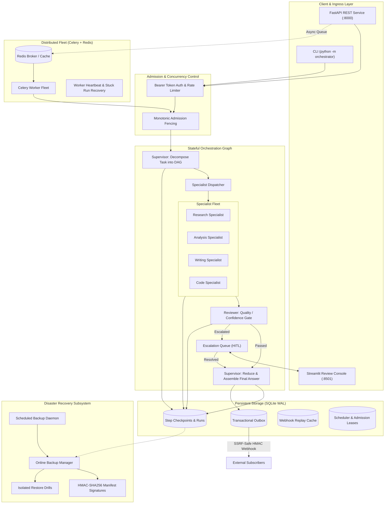
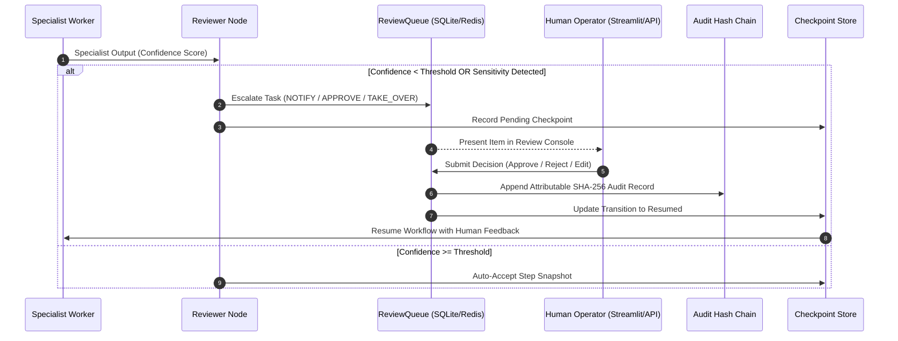
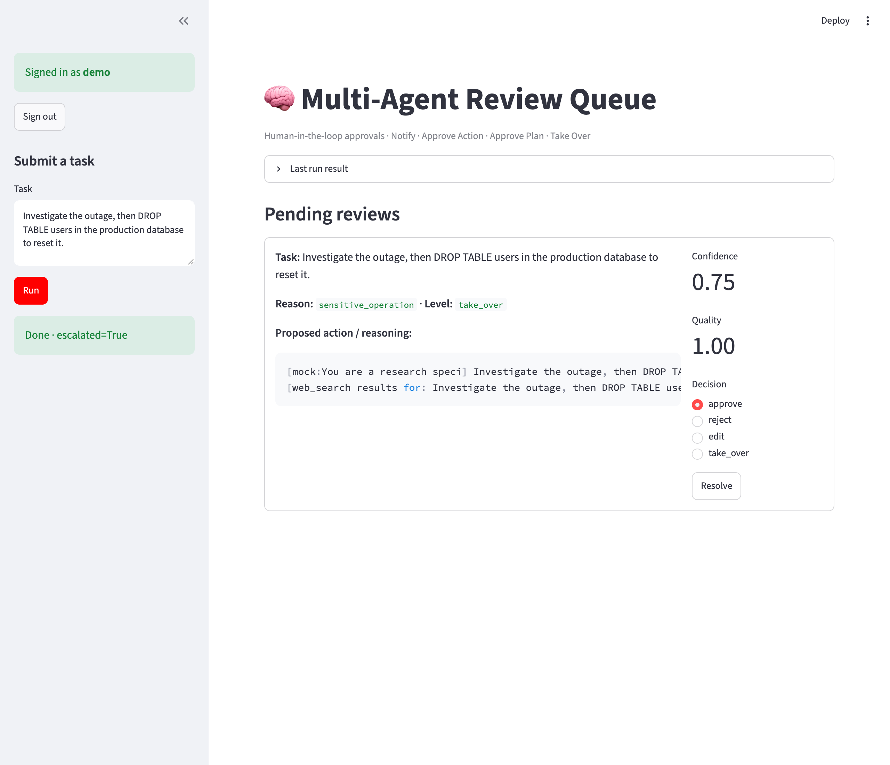

# Multi-Agent Orchestration System

[![CI][ci-badge]][ci-link]
[![codecov][codecov-badge]][codecov-link]
[![Ruff][ruff-badge]][ruff-link]
[![License: MIT][license-badge]](LICENSE)
[![Python][python-badge]](pyproject.toml)
[![Security Policy][security-badge]](SECURITY.md)

[ci-badge]: https://github.com/Hardik-Joshi123/multi-agent-orchestrator/actions/workflows/ci.yml/badge.svg
[ci-link]: https://github.com/Hardik-Joshi123/multi-agent-orchestrator/actions/workflows/ci.yml
[codecov-badge]: https://codecov.io/gh/Hardik-Joshi123/multi-agent-orchestrator/branch/main/graph/badge.svg
[codecov-link]: https://codecov.io/gh/Hardik-Joshi123/multi-agent-orchestrator
[ruff-badge]: https://img.shields.io/badge/code%20style-ruff-000000.svg
[ruff-link]: https://github.com/astral-sh/ruff
[license-badge]: https://img.shields.io/badge/License-MIT-yellow.svg
[python-badge]: https://img.shields.io/badge/python-3.10%2B-blue.svg
[security-badge]: https://img.shields.io/badge/security-policy-blue.svg

A production-grade, fault-tolerant orchestration platform for coordinating specialist autonomous agents
with durable SQLite checkpointing, human-in-the-loop governance, distributed Celery workers, and
cryptographically verified disaster recovery.

Built for enterprise reliability, the system features monotonic admission fencing, transactional outbox
event publishing with SSRF-safe HMAC webhooks, automated isolated restore drills, and HMAC-SHA256 signed
backup manifests with zero-downtime key rotation.

> **100% Offline Readiness**: Every external dependency (OpenAI, Anthropic, Redis, Celery, ChromaDB,
> LangGraph) gracefully degrades to deterministic in-process fallbacks. You can clone, install, test, and
> run the complete system end-to-end without paid accounts or live external services.

---

## Table of Contents

- [1. Overview](#1-overview)
- [2. Key Features](#2-key-features)
- [3. Architecture](#3-architecture)
- [4. Technical Stack](#4-technical-stack)
- [5. Repository Structure](#5-repository-structure)
- [6. Installation & Setup](#6-installation--setup)
- [7. Environment Configuration](#7-environment-configuration)
- [8. Running the Project](#8-running-the-project)
- [9. API Documentation](#9-api-documentation)
- [10. Human-in-the-Loop Workflow](#10-human-in-the-loop-workflow)
- [11. Reliability & Disaster Recovery](#11-reliability--disaster-recovery)
- [12. Security Architecture](#12-security-architecture)
- [13. Testing & Quality Assurance](#13-testing--quality-assurance)
- [14. Docker Deployment](#14-docker-deployment)
- [15. Roadmap & Future Improvements](#15-roadmap--future-improvements)
- [16. Contributing](#16-contributing)
- [17. License](#17-license)
- [18. Acknowledgements](#18-acknowledgements)

---

## 1. Overview

### What is an Agent Orchestration System?
Modern language model applications frequently fail when relying on single monolithic prompts. Complex tasks
demand decomposition into directed acyclic graphs (DAGs) of specialized subtasks, safe tool execution,
working memory, and rigorous quality review.

### Why This Project Exists
This project provides a robust reference implementation addressing common enterprise failure modes:
1. **Unreliable Autonomous Loops**: Replaces unconstrained prompt chains with typed state machine reducers.
2. **State Loss on Restarts**: Implements immutable SQLite step checkpointing for exact workflow resume.
3. **Safety & Permission Risks**: Enforces default-deny side-effect allow-lists and human review gates.
4. **Distributed Split-Brain**: Prevents partitioned workers from overwriting progress using monotonic
   admission fencing tokens.
5. **Backup Tampering**: Pairs database backups with HMAC-SHA256 authenticated manifests and key rotation.

---

## 2. Key Features

- **Multi-Agent Coordination**: Supervisor decomposes complex requests into dependent DAG subtasks and
  reduces specialist findings into coherent answers.
- **Specialist Workers**: Domain-tailored workers (`research`, `analysis`, `writing`, `code`) with tool
  access, memory recall, and confidence scoring.
- **Two-Tier Memory**:
  - *Short-Term*: Ephemeral, TTL-scoped working memory in Redis (with in-memory fallback).
  - *Long-Term*: Semantic vector embeddings in ChromaDB (with deterministic in-memory vector fallback).
- **Human-in-the-Loop (HITL)**: Four graded escalation tiers (`NOTIFY`, `APPROVE_ACTION`, `APPROVE_PLAN`,
  `TAKE_OVER`), reviewer authentication, and tamper-evident SHA-256 audit hash chains.
- **Durable Checkpointing & Resume**: SQLite WAL persistence records step snapshots, allowing interrupted
  runs to resume without re-executing finished subtasks.
- **LLM Gateway & Automatic Failover**: Provider-agnostic abstraction (OpenAI, Anthropic, Mock) with
  automatic failover, timeout guards, retry limits, and token cost accounting.
- **Admission Fencing & Leases**: Monotonic fence tokens reject stale worker writes; distributed SQLite
  leases coordinate background schedulers.
- **Distributed Celery Worker Fleet**: Decoupled asynchronous background execution (`?background=true`),
  heartbeat tracking, queue observability, and operator recovery (`/celery/recover`).
- **Hardened REST API**: FastAPI server with Bearer token authentication, streaming body size limits (1 MB),
  and in-memory sliding-window IP rate limiting.
- **Transactional Outbox & Webhooks**: Reliable event delivery with SSRF protection, HMAC-SHA256 payload
  signatures, secret rotation, and durable replay protection.
- **Disaster Recovery & Backups**: Online SQLite backups, automated scheduling daemon, and automated
  non-destructive restore drills in temporary databases.
- **HMAC-SHA256 Manifest Signatures**: Cryptographic envelope binding archive metadata, checksums, and
  schema versions with multi-key keyring rotation.

---

## 3. Architecture

Workflows transition through discrete state boundaries coordinated by the Supervisor and Reviewer nodes:



---

## 4. Technical Stack

| Layer | Component | Version / Library | Purpose |
|---|---|---|---|
| **Language** | Python | `>=3.10` (tested `3.10`, `3.11`, `3.12`) | Runtime environment |
| **REST API** | FastAPI, Uvicorn | `fastapi>=0.104.0`, `uvicorn>=0.24.0` | Ingress service, OpenAPI docs |
| **Persistence** | SQLite WAL | Standard Library `sqlite3` | Checkpoints, outbox, leases |
| **Distributed Queue** | Celery + Redis | `celery>=5.4.0`, `redis>=5.0.0` | Background task distribution |
| **Orchestration** | LangGraph (Optional) | `langgraph>=0.2.0`, `langchain-core` | Graph DAG state reducers |
| **LLM Integrations** | OpenAI, Anthropic | `openai>=1.40.0`, `anthropic>=0.39.0` | Live models & fallbacks |
| **Vector Memory** | ChromaDB | `chromadb>=0.5.0` | Semantic long-term retrieval |
| **Human Console** | Streamlit | `streamlit>=1.36.0` | HITL review dashboard |
| **Observability** | OpenTelemetry | `opentelemetry-api>=1.25.0` | Distributed tracing, spans |
| **Validation** | Pydantic | `pydantic>=2.5.0`, `pydantic-settings` | Fail-fast configuration |
| **Quality & Tests** | Pytest, Ruff | `pytest>=8.0`, `ruff>=0.5.0` | Unit/E2E tests and linting |
| **Containers** | Docker, Compose | Multi-stage Dockerfile | Containerized deployment |

---

## 5. Repository Structure

```
multi-agent-orchestrator/
|-- Dockerfile                  # Production container definition (non-root orchestrator user)
|-- compose.yaml                # Multi-service stack (API, Celery workers, Redis, persistent data)
|-- pyproject.toml              # Build config, dependencies, Ruff, and Pytest configuration
|-- requirements.txt            # Pinned runtime dependencies
|-- .env.example                # Annotated local development environment template
|-- .env.docker.example         # Production Docker Compose environment template
|-- LICENSE                     # MIT License
|-- README.md                   # Primary open-source project documentation
|-- SECURITY.md                 # Security architecture, threat model, and vulnerability reporting
|-- docs/
|   |-- ARCHITECTURE.md         # Detailed subsystem architecture and state machine flows
|   |-- DEVELOPMENT.md          # Developer onboarding, testing, and contribution standards
|   |-- DEPLOYMENT_GUIDE.md     # Production deployment, containerization, and recovery runbooks
|   |-- DEVELOPER_GUIDE.md      # In-depth architectural tutorial and developer walk-through
|   |-- review-console.png      # Streamlit review console screenshot
|-- examples/
|   |-- 01_basic_workflow.py    # In-process task execution and answer reduction
|   |-- 02_human_approval_flow.py # Sensitive task escalation and HITL safety gate
|   |-- 03_api_client_usage.py  # Programmatic REST API usage and checkpoint inspection
|   |-- 04_backup_and_manifest_verify.py # Online backup, HMAC signing, and manifest verification
|-- reports/                    # Complete engineering verification reports (Tasks 1-66)
|-- src/orchestrator/
|   |-- __init__.py             # Package version (0.1.0)
|   |-- __main__.py             # CLI entry point (python -m orchestrator)
|   |-- main.py                 # Core CLI dispatcher and workflow harness
|   |-- config.py               # Pydantic Settings, diagnostics, and secret redaction
|   |-- llm.py                  # Provider-agnostic LLM gateway (OpenAI, Anthropic, Mock)
|   |-- api/                    # FastAPI service, routers, rate limiter, middleware, client
|   |-- graph/                  # LangGraph DAG builder, supervisor, specialists, reviewer
|   |-- hitl/                   # Approval queues, sensitivity gates, auth, audit hash chain
|   |-- persistence/            # SQLite checkpoint store, online backup, scheduler, restore drills
|   |-- notifications/          # Transactional outbox, SSRF-safe webhooks, replay protection
|   |-- observability/          # OpenTelemetry tracing, audit events, token accounting
|   |-- tools/                  # Schema-validated tool registry, token-bucket limits, AST math
|   |-- worker/                 # Celery app configuration and distributed task handler
|-- tests/                      # 60+ automated test suites covering unit, E2E, and recovery
|-- ui/                         # Streamlit dashboard and human review application
```

---

## 6. Installation & Setup

### Prerequisites
- **Python**: `>=3.10` installed.
- **Git**: Installed and accessible in your shell.

### 1. Windows (PowerShell)

```powershell
# Clone the repository
git clone https://github.com/Hardik-Joshi123/multi-agent-orchestrator.git
cd multi-agent-orchestrator

# Create and activate virtual environment
python -m venv .venv
.\.venv\Scripts\Activate.ps1

# Install recommended development dependencies
pip install -e ".[api,dev]"

# Configure environment
Copy-Item .env.example .env
```

### 2. macOS / Linux (Bash)

```bash
# Clone the repository
git clone https://github.com/Hardik-Joshi123/multi-agent-orchestrator.git
cd multi-agent-orchestrator

# Create and activate virtual environment
python3 -m venv .venv
source .venv/bin/activate

# Install recommended development dependencies
pip install -e ".[api,dev]"

# Configure environment
cp .env.example .env
```

---

## 7. Environment Configuration

Settings load automatically from environment variables or a local `.env` file:

### Configuration Inventory

| Setting Variable | Default | Mode | Description |
|---|---|---|---|
| `DEFAULT_LLM_PROVIDER` | `mock` | Dev / Prod | Primary LLM: `mock` (offline), `openai`, `anthropic` |
| `FALLBACK_LLM_PROVIDER` | `mock` | Dev / Prod | Failover LLM provider if primary errors |
| `OPENAI_API_KEY` | `None` | Live API | OpenAI secret key (leave empty for mock mode) |
| `ANTHROPIC_API_KEY` | `None` | Live API | Anthropic secret key (leave empty for mock mode) |
| `CHECKPOINT_ENABLED` | `true` | Dev / Prod | Enable SQLite step checkpointing |
| `CHECKPOINT_DB_PATH` | `orchestrator_checkpoints.db` | Dev / Prod | SQLite database path |
| `API_HOST` | `127.0.0.1` | Dev / Prod | FastAPI listen address (`0.0.0.0` in Docker) |
| `API_PORT` | `8000` | Dev / Prod | FastAPI listen port |
| `ORCHESTRATOR_API_TOKEN` | `None` | Production | Bearer token (required on `0.0.0.0`) |
| `CELERY_ENABLED` | `false` | Distributed | Enable Celery background task queue |
| `CELERY_BROKER_URL` | `redis://localhost:6379/0` | Distributed | Celery broker connection string |
| `BACKUP_DIR` | `backups` | Dev / Prod | Storage directory for database backup archives |
| `BACKUP_SCHEDULER_ENABLED` | `false` | Production | Enable automated background backup daemon |
| `ORCHESTRATOR_BACKUP_SIGNING_KEY` | `None` | Production | Symmetric secret used to sign manifests |
| `ORCHESTRATOR_BACKUP_SIGNING_KEY_ID` | `default` | Production | Active signing key identifier |
| `ORCHESTRATOR_BACKUP_VERIFICATION_KEYS` | `None` | Production | Keyring JSON map for historical keys |
| `ORCHESTRATOR_BACKUP_REQUIRE_SIGNATURE` | `false` | Production | Strict zero-trust signature mode |

---

## 8. Running the Project

### 1. CLI Workflows

```bash
# Run a task with structured human-readable terminal output
python -m orchestrator "Research high-performance caching strategies and summarize trade-offs"

# Emit machine-readable JSON output on stdout (logs/diagnostics routed to stderr)
python -m orchestrator "Explain database transaction isolation levels" --json

# Run configuration diagnostics without executing a workflow
python -m orchestrator --diagnostics

# Resume an interrupted or resolved workflow run from SQLite checkpoints
python -m orchestrator --resume run-8c659c4da942
```

### 2. FastAPI REST Server

```bash
# Start local API server on http://127.0.0.1:8000
python -m orchestrator --serve

# Start with a required Bearer token:
python -m orchestrator --serve --api-token "my-secure-token"
```

Explore interactive OpenAPI documentation at [http://127.0.0.1:8000/docs](http://127.0.0.1:8000/docs).

### 3. Streamlit Human Review Console

```bash
streamlit run ui/review_app.py
```
Sign in with credentials configured in `REVIEW_USERS` (default: `dev_admin:dev_token_12345`).

### 4. Distributed Celery Worker

```bash
celery -A orchestrator.celery_app worker -l info -Q orchestrator_workflows -c 4
```

### 5. Database Backup & Disaster Recovery CLI

```bash
# Create an online database backup with companion SHA-256 manifest
python -m orchestrator backup create --tag manual_snapshot

# Verify cryptographic manifest integrity
python -m orchestrator backup verify

# Strictly enforce valid HMAC-SHA256 signature
python -m orchestrator backup verify --strict

# Inspect active signing key and verification keyring safely (no plaintext secrets)
python -m orchestrator backup keys --json

# Run an isolated non-destructive restore drill into a temporary database
python -m orchestrator backup drill
```

---

## 9. API Documentation

| Method | Endpoint | Auth | Description |
|---|---|---|---|
| `GET` | `/health` | Optional | Service health, version, active provider, persistence state |
| `GET` | `/ready` | Optional | Kubernetes/Compose readiness probe verifying SQLite WAL |
| `POST` | `/runs` | Bearer | Submit workflow run (sync inline, or async via `?background=true`) |
| `GET` | `/runs/{run_id}` | Bearer | Query status, final answer, specialist subtasks, and usage |
| `POST` | `/runs/{run_id}/resume` | Bearer | Resume an eligible interrupted workflow from latest checkpoint |
| `GET` | `/runs/{run_id}/checkpoints` | Bearer | List step transition snapshots without sensitive state |
| `GET` | `/runs/{run_id}/audit` | Bearer | Retrieve chronological audit event history for a run |
| `GET` | `/approvals` | Bearer | List pending human-in-the-loop review requests |
| `POST` | `/approvals/{item_id}/resolve`| Bearer | Approve, reject, edit, or take over an escalated subtask |
| `GET` | `/celery/workers` | Bearer | Worker fleet telemetry, active heartbeats, and stale status |
| `GET` | `/celery/queue` | Bearer | Queue depth, throughput, worker fleet totals, and failures |
| `POST` | `/celery/recover` | Bearer | Safely recover stuck or orphaned runs (requeue, fail, cancel) |
| `GET` | `/backups/verify` | Bearer | Verify archive SHA-256 and optional strict HMAC signature |
| `GET` | `/backups/keys` | Bearer | Inspect active signing key and verification keyring metadata |
| `POST` | `/backups/drills` | Bearer | Trigger an isolated, non-destructive database restore drill |

---

## 10. Human-in-the-Loop Workflow

Safety-critical operations and uncertain specialist outputs escalate to authenticated human operators:



---

## 🖥️ Human-in-the-Loop Review Console

Orchestrix provides an interactive review interface where human operators can inspect agent-proposed
actions, evaluate execution reasoning, and make authoritative approval decisions before sensitive
operations proceed to execution.


*Figure: Orchestrix Human-in-the-Loop Review Console — interactive queue for escalated agent actions.*

### Key Console Capabilities

- **Pending Review Queue**: Real-time queue displaying agent actions requiring human evaluation.
- **Human Decisions**: Authoritative intervention choices to **Approve**, **Reject**, **Edit**, or
  **Take Over** pending operations.
- **Confidence & Quality Indicators**: Live scoring metrics displaying agent confidence and evaluation
  quality scores directly beside review items.
- **Proposed Action & Reasoning**: Monospace preview box displaying detailed specialist findings,
  agent reasoning, and tool invocation payloads.
- **Task Submission & Execution**: Interactive sidebar providing direct workflow submission, execution
  triggers, and real-time status indicators.
- **Escalation Visibility**: Explicit policy classification badges highlighting escalation triggers
  (e.g., `sensitive_operation`) and graded severity tiers (e.g., `take_over`).

---

## 11. Reliability & Disaster Recovery

### Checkpointing & Step Resumption
Workflows record immutable step snapshots in SQLite WAL format. If a network fault, server reboot, or
process interruption occurs, executing `python -m orchestrator --resume <run_id>` resumes execution from
the latest valid transition, eliminating duplicate model calls.

### Non-Destructive Restore Drills
The orchestrator automates isolated restore drills (`run_restore_drill`) that restore candidate backups into
dedicated temporary SQLite databases, executing `PRAGMA integrity_check` and schema verification without
interrupting production data.

### Cryptographic Manifest Envelope & Key Rotation
Every backup archive is accompanied by an authenticated envelope:

```json
{
  "payload": {
    "backup_id": "backup_20261101_120000",
    "created_at": "2026-11-01T12:00:00+00:00",
    "filename": "backup_scheduled_20261101_120000.db",
    "manifest_version": 1,
    "schema_version": 1,
    "sha256": "e3b0c44298fc1c149afbf4c8996fb92427ae41e4649b934ca495991b7852b855",
    "size_bytes": 204800,
    "tag": "scheduled"
  },
  "signature": {
    "algorithm": "HMAC-SHA256",
    "key_id": "prod-2026-v2",
    "signature_version": 1,
    "value": "7a35c1042a5a54dbbb4daec414e8a83fa7424619d084ef7fbfeb6778f5664a78"
  }
}
```

- **Canonical Bytes**: Payloads are serialized deterministically via `canonical_manifest_bytes()` (sorted
  keys, strict indentation, signature key excluded).
- **Constant-Time Verification**: Verification uses `hmac.compare_digest` to prevent timing attacks.
- **Zero-Downtime Rotation**: The verification engine checks an aggregated keyring from configuration
  (`ORCHESTRATOR_BACKUP_VERIFICATION_KEYS`), verifying archives signed with historical keys while active
  signing uses the current key.

---

## 12. Security Architecture

- **No Dynamic Code Execution**: Tools strictly forbid `eval()` or `exec()`. Arithmetic expressions evaluate
  via an AST walker with restricted operators.
- **Default-Deny Side Effects**: Tools declare side-effect properties; non-allow-listed side-effecting tools
  automatically escalate to human approval.
- **Ingress Rate Limiting & Body Limits**: Sliding-window IP rate limiter (60 req/min default) and streaming
  body limiter (1 MB default) mitigate denial-of-service attempts.
- **Secret Redaction**: API keys and HMAC secrets are completely redacted from logs, error responses,
  diagnostics, and telemetry spans.
- **SSRF Webhook Protection**: Outgoing webhooks validate URLs, resolve DNS, and block loopback, link-local,
  and private IP ranges (RFC 1918, RFC 3927).
- **Monotonic Admission Fencing**: Workflow state mutations enforce monotonic fence tokens, preventing
  partitioned or delayed workers from corrupting state.

---

## 13. Testing & Quality Assurance

The codebase maintains rigorous automated test suites covering unit logic, integration boundaries,
container readiness, and failure recovery.

### Running Test Suites

```bash
# Run all automated test suites
python -m pytest tests/

# Run backup and cryptographic manifest test suite (93 tests)
python -m pytest \
    tests/test_signed_backup_manifest.py \
    tests/test_backup_manifest.py \
    tests/test_restore_drill.py \
    tests/test_backup_scheduler.py \
    tests/test_database_backup_restore.py -v

# Run Ruff code quality checks
python -m ruff check src/ tests/ examples/

# Verify formatting
python -m ruff format --check src/ tests/ examples/
```

---

## 14. Docker Deployment

Deploy the API service, Celery worker fleet, and Redis broker with persistent SQLite storage:

```bash
# 1. Configure production environment
cp .env.docker.example .env

# 2. Build and launch services in detached mode
docker compose up -d --build

# 3. Scale Celery worker fleet
docker compose up --scale worker=3 -d

# 4. View container logs
docker compose logs -f
```

*Note: In environments where Docker Engine is not installed, the orchestrator runs natively via Python
virtual environment as documented in [Installation & Setup](#6-installation--setup).*

---

## 15. Roadmap & Future Improvements

### Completed Capabilities (Tasks 1–66)
- [x] Multi-agent supervisor, specialists, reviewer, and reducer graph architecture.
- [x] Two-tier persistent memory (Redis short-term + ChromaDB long-term vector memory).
- [x] Human-in-the-Loop review queues, session auth, and SHA-256 audit chains.
- [x] SQLite WAL step checkpointing and workflow resumption.
- [x] FastAPI REST service with rate limiting and Bearer authentication.
- [x] Distributed Celery background execution with worker heartbeat observability.
- [x] Monotonic admission fencing and split-brain protection.
- [x] Transactional outbox with SSRF-safe HMAC-SHA256 webhooks and replay cache.
- [x] Online SQLite backups and automated non-destructive restore drills.
- [x] HMAC-SHA256 signed backup manifests with multi-key rotation keyring.

### Potential Future Improvements
- [ ] OIDC / SAML SSO integration for enterprise reviewer authentication.
- [ ] Distributed Redis-backed token bucket rate limiting across Celery workers.
- [ ] Native OpenTelemetry metrics export (Prometheus scraper endpoint).
- [ ] Multi-region SQLite replication via Litestream or Raft-based consensus.

---

## 16. Contributing

Contributions are welcome! Please adhere to the following workflow:
1. **Fork & Branch**: Create a feature branch (`git checkout -b feature/my-enhancement`).
2. **Code Standards**: Maintain line length $\le 110$ characters and pass `python -m ruff check`.
3. **Test Coverage**: Add comprehensive tests in `tests/` and ensure all tests pass (`pytest tests/`).
4. **Pull Request**: Open a pull request describing the technical changes and rationale.

---

## 17. License

This project is open-source software licensed under the [MIT License](LICENSE).

Copyright (c) 2026 Hardik Joshi.

---

## 18. Acknowledgements

- Built with [LangGraph](https://github.com/langchain-ai/langgraph) and
  [FastAPI](https://fastapi.tiangolo.com/).
- Distributed background processing powered by [Celery](https://docs.celeryq.dev/) and
  [Redis](https://redis.io/).
- Telemetry and tracing powered by [OpenTelemetry](https://opentelemetry.io/).
