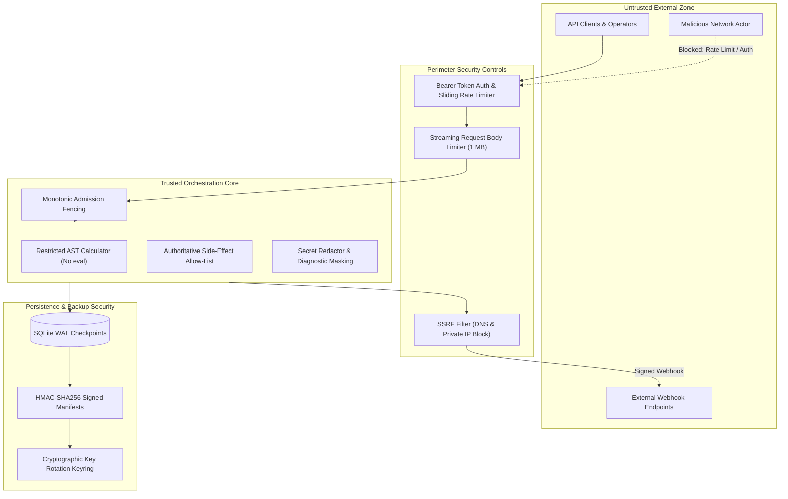

# Security Architecture & Policies

This document details the security posture, threat model, and defense-in-depth controls implemented
across the Multi-Agent Orchestration System.

---

## 1. Threat Model & Security Posture

The orchestrator operates under a defense-in-depth security model addressing threats at multiple
architectural boundaries:

---

## 2. Authentication & Authorization

### 2.1 API Ingress Authentication
- **Bearer Token Enforcement**: Binding to non-loopback interfaces (e.g. `0.0.0.0`) strictly requires setting
  `ORCHESTRATOR_API_TOKEN`. Unauthenticated external requests return `401 Unauthorized`.
- **Zero-Downtime Token Rotation**: Operators can supply `ORCHESTRATOR_API_TOKEN_PREVIOUS` to accept both old
  and new tokens simultaneously during active client migrations.
- **Constant-Time Verification**: All token and credential comparisons use `hmac.compare_digest` to eliminate
  side-channel timing vulnerabilities.

### 2.2 Human-in-the-Loop Review Authentication
- **Reviewer Sign-In**: The Streamlit console and HITL API enforce authentication against configured
  `REVIEW_USERS` (`username:token` pairs).
- **Session Expiry**: Reviewer sessions expire after `REVIEW_SESSION_TIMEOUT_MINUTES` (default: 15 minutes).
- **Tamper-Evident Audit Chain**: Every review action records an immutable, attributable entry in a SHA-256
  cryptographic audit hash chain (`AuditChain.verify()`).

---

## 3. Tool Execution & Code Safety

- **No Arbitrary Code Execution**: The orchestrator strictly avoids `eval()`, `exec()`, or dynamic code
  loading on untrusted input.
- **Restricted AST Arithmetic**: The `calculator` tool evaluates arithmetic expressions exclusively using an
  AST walker (`tools/registry.py`), allowing only `+ - * / %` and unary operators. Exponentiation (`**`) is
  blocked to prevent CPU denial-of-service (e.g. `9**9**9`).
- **Authoritative Side-Effect Allow-List**: Tools declare whether they cause side effects. The reviewer
  escalates (default-deny) whenever a side-effecting tool is invoked unless explicitly allow-listed.
- **Sensitivity Classifier**: Normalized regex heuristics detect common destructive commands (e.g.
  `DROP TABLE`, `rm -rf`) as secondary defense-in-depth against prompt injection.
- **Token-Bucket Rate Limiting**: Every tool enforces a token-bucket rate limit to mitigate runaway loops.

---

## 4. Ingress Protection & DoS Mitigation

- **Streaming Body Size Limit**: Middleware checks request content lengths before buffering, rejecting
  payloads exceeding `API_MAX_BODY_BYTES` (default: 1 MB) with `413 Request Entity Too Large`.
- **Sliding-Window Rate Limiting**: In-memory sliding-window limiter blocks IP addresses exceeding
  `API_RATE_LIMIT_REQUESTS` (default: 60 requests per 60 seconds) with `429 Too Many Requests`.
- **Trusted Reverse Proxy Support**: Client IP extraction inspects `X-Forwarded-For` only when requests
  originate from configured `API_TRUSTED_PROXIES`.

---

## 5. Secret Redaction & Diagnostic Safety

- **Zero Plaintext Secrets in Logs**: API keys (`sk-...`), Bearer tokens, and HMAC signing keys are never
  logged, returned in error messages, or printed in diagnostics.
- **Startup Configuration Validation**: The orchestrator verifies settings at startup and refuses to launch
  if placeholders (e.g. `replace_with_`) remain configured on production interfaces (`0.0.0.0`).
- **Keyring Metadata Telemetry**: The `GET /backups/keys` endpoint and CLI commands return only key IDs and
  secret lengths (e.g. 32 bytes) without revealing secret contents.

---

## 6. Outbox Webhook Security & SSRF Protection

- **SSRF Prevention**: The outbox dispatcher resolves destination hostnames and rejects private, loopback,
  and link-local IP addresses (RFC 1918, RFC 3927) unless explicitly allowed for development.
- **Mandatory HTTPS**: In production mode, webhook URLs must use TLS (`https://`).
- **HMAC-SHA256 Payload Signatures**: Outgoing webhooks are signed using HMAC-SHA256 with timestamp headers
  (`X-Webhook-Signature`).
- **Durable Replay Protection**: Webhook deliveries cache delivery IDs in SQLite with automatic TTL pruning,
  preventing replay attacks.

---

## 7. Distributed Fencing & Disaster Recovery

- **Monotonic Admission Fencing**: Workflow admissions use monotonic fence tokens in SQLite. Partitioned or
  delayed workers cannot commit updates over newer workflow states.
- **Online Backup Safety**: SQLite online backup API copies databases in WAL mode without locking or
  corrupting in-flight transactions.
- **Cryptographic Manifest Signatures**: Backup archives are paired with HMAC-SHA256 signed manifests
  verifying archive checksum, size, SQLite schema version, and metadata.
- **Key Rotation Keyring**: The backup subsystem supports multi-key keyrings for zero-downtime key rotation
  and strict zero-trust enforcement (`ORCHESTRATOR_BACKUP_REQUIRE_SIGNATURE=true`).

---

## 8. Vulnerability Reporting

If you discover a security vulnerability in this project, please report it privately:

- **Security Contact**: Contact the project maintainer via GitHub Private Security Advisories.
- **Disclosure Policy**: Please allow 30 days for investigation and patching before public disclosure.
