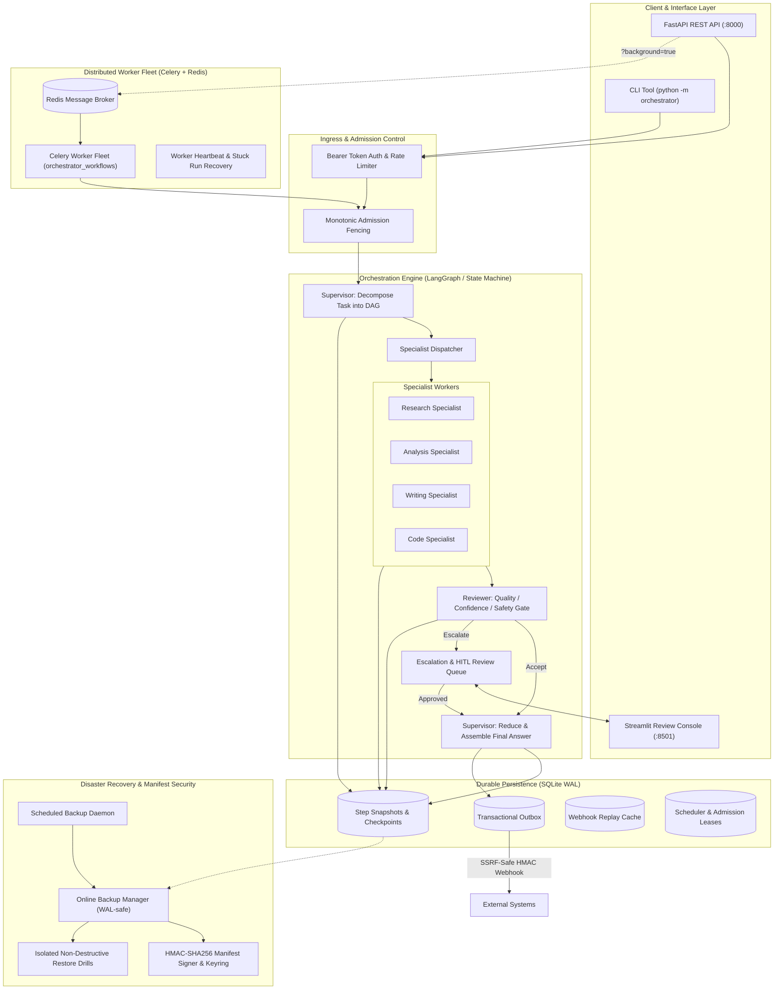

# Architecture & System Design

## 1. System Overview

The Multi-Agent Orchestration System is a distributed, fault-tolerant workflow orchestration engine
designed for coordinating specialist autonomous agents under strict reliability, safety, and auditability
guarantees.

The architecture decouples workflow coordination, task execution, human-in-the-loop (HITL) governance,
persistent state checkpointing, and disaster recovery into modular, testable subsystems.

---

## 2. Core Architectural Subsystems

### 2.1 Workflow State Machine & LangGraph Reducers

Workflows operate as state machines over an immutable, typed `GraphState`:
- **State Merging via Reducers**: Parallel specialist outputs accumulate without race conditions using
  deterministic list concatenation reducers (`operator.add`).
- **Step Transitions**: Every transition (`decompose`, `specialist`, `review`, `reduce`, `hitl`) triggers an
  atomic step snapshot in the persistent checkpoint store.
- **Resumption**: When a paused or interrupted workflow resumes, already completed subtasks are loaded from
  the database, bypassing redundant LLM invocations and token expenditure.

### 2.2 Admission Control, Fencing & Leases

In distributed environments where multiple Celery workers or API threads may process jobs:
- **Monotonic Fence Tokens**: Every workflow admission increments a monotonic fence token in the database.
- **Stale Worker Rejection**: If a network-partitioned worker attempts to commit a result with an outdated
  fence token, the write is rejected with `AdmissionFencingError`.
- **Distributed Leases**: Background schedulers (e.g. backup scheduler, restore drill daemon) acquire
  time-bounded leases in SQLite to guarantee single-master execution.

### 2.3 Human-in-the-Loop (HITL) Governance

Safety-critical actions and low-confidence operations require human oversight:
- **Graded Escalation Levels**:
  - `NOTIFY`: Non-blocking informational notification.
  - `APPROVE_ACTION`: Halts execution pending authorization of a specific tool call.
  - `APPROVE_PLAN`: Halts execution pending human sign-off on the decomposed DAG plan.
  - `TAKE_OVER`: Immediate cessation of automated execution requiring manual operator resolution.
- **Authoritative Side-Effect Gate**: Side-effecting tools are blocked by default unless explicitly
  allow-listed.
- **Tamper-Evident Audit Chain**: Every review decision is recorded to an append-only cryptographic hash
  chain verified with SHA-256 digests.

### 2.4 Transactional Outbox & Webhook Delivery

Reliable notification delivery to external systems uses the Transactional Outbox pattern:
- **Atomic Event Insertion**: Outbox notifications are inserted in the same database transaction as the
  workflow completion state.
- **SSRF Protection**: Outbound webhook dispatch performs strict URL validation, DNS resolution checks, and
  blocks private/loopback/link-local IP addresses (RFC 1918, RFC 3927).
- **HMAC Payload Authentication**: Outgoing webhooks are signed using HMAC-SHA256 with timestamp headers
  and tolerance windows to prevent message forgery.
- **Durable Replay Protection**: Webhook deliveries record unique delivery identifiers in a dedicated
  replay table to prevent duplicate processing.

### 2.5 Disaster Recovery & Backup Integrity

- **Online SQLite Backups**: Backups leverage SQLite's online backup API, supporting concurrent live WAL reads
  and writes without process locking or corruption.
- **Isolated Restore Drills**: Scheduled background restore drills verify backup viability by restoring into
  isolated temporary databases and running SQLite integrity checks (`PRAGMA integrity_check`) without
  touching live data.
- **Cryptographic Manifest Envelope**: Each backup archive is accompanied by an HMAC-SHA256 signed manifest
  binding `backup_id`, `filename`, `size_bytes`, `schema_version`, and the archive's SHA-256 digest.
- **Zero-Downtime Key Rotation**: Verification keys are managed as an aggregated keyring, allowing seamless
  verification of historical backups while signing new archives with current keys.

---

## 3. Component Responsibility Matrix

| Subsystem | Package Path | Primary Responsibilities |
|---|---|---|
| **API Server** | `orchestrator.api` | REST endpoints, token auth, rate limiting, payload validation |
| **Graph Engine** | `orchestrator.graph` | LangGraph assembly, supervisor, specialists, reviewer |
| **HITL Layer** | `orchestrator.hitl` | Review queues, sensitivity gates, approval lifecycles |
| **Persistence** | `orchestrator.persistence` | SQLite WAL checkpoints, leases, fencing, backups |
| **Notifications** | `orchestrator.notifications` | Outbox dispatcher, SSRF-safe webhooks, replay cache |
| **Observability** | `orchestrator.observability` | OpenTelemetry tracing, audit events, token accounting |
| **Tools** | `orchestrator.tools` | Schema-validated tools, token-bucket limits, AST math |
| **Worker Fleet** | `orchestrator.worker` | Celery tasks, worker heartbeats, stuck run recovery |

---

## 4. Concurrency & Reliability Guarantees

1. **At-Least-Once Delivery Resilience**: Celery workers support idempotent task retries. Terminal runs
   ignore duplicate delivery signals.
2. **Graceful Shutdown**: The API server traps `SIGTERM`/`SIGINT`, draining active workflows within a
   configurable grace period before closing database connections.
3. **Offline Zero-Dependency Guarantee**: Every external dependency (OpenAI, Anthropic, Redis, Celery,
   ChromaDB) degrades gracefully to deterministic in-process fallbacks.
