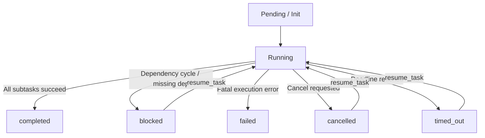

# Task 28: Workflow Cancellation & Execution Deadlines Report

**Date**: 2026-10-22  
**Author**: Antigravity  
**Repository**: `multi-agent-orchestrator`  
**Working Directory**: `C:\Users\Dell\OneDrive\Desktop\Project\multi-agent-orchestrator`  

---

## 1. Executive Summary

Task 28 implemented end-to-end cooperative workflow cancellation and execution deadlines across the Multi-Agent Orchestration System. Previously, workflows lacked a cooperative cancellation mechanism, execution timeout enforcement, and dedicated terminal states for aborted or expired tasks.

### Key Accomplishments
1. **Cooperative Cancellation Token & Registry**:
   - Implemented thread-safe `CancellationToken` and `CancellationRegistry` in `src/orchestrator/graph/cancellation.py`.
   - Allows fine-grained, thread-safe cancellation signaling with cancellation reasons and timestamps.
2. **Execution Deadlines & Configuration**:
   - Added `workflow_timeout_seconds` configuration field in `Settings` (`src/orchestrator/config.py`) with strict validation (`0 < timeout <= 86400.0s`).
   - Integrated `--timeout` argument into the CLI (`src/orchestrator/main.py`), supporting positive float deadlines and graceful SIGINT (Ctrl+C, exit code 130) handling.
   - Supported `timeout_seconds` in `CreateRunRequest` and `ResumeRunRequest` API schemas.
3. **Cooperative Dispatch & Thread-Pool Safety**:
   - Updated `_run_fallback` and `_execute_subtask_with_review` in `src/orchestrator/graph/builder.py`:
     - Checks token cancellation and deadline before dispatching any subtasks.
     - Performs 0.2s bounded wait slices (`concurrent.futures.wait`) to guarantee responsive wakeups when cancelled or timed out.
     - Immediately cancels unstarted futures via `fut.cancel()`.
     - When cancelling or timing out, uses `executor.shutdown(wait=False, cancel_futures=True)` so slow in-flight external workers do not block the orchestration thread.
     - Inspects cancellation and deadline inside the subtask retry loop.
4. **Distinct Terminal States & Work Preservation**:
   - Explicitly differentiated terminal statuses: `cancelled` and `timed_out` (distinct from `failed`, `partial`, and `blocked`).
   - `supervisor.reduce` formats markdown responses preserving all completed subtask results while detailing which subtasks remained unexecuted due to cancellation/timeout.
   - State checkpoints saved with transitions `"cancelled"` and `"timed_out"`.
   - Resumption (`resume_task` / `POST /runs/{run_id}/resume`) preserves all completed (`status == "done"`) subtask outputs, resetting status to `"running"` and executing only remaining unfinished work.
5. **API & Client Integration**:
   - Created `POST /runs/{run_id}/cancel` route protected by Bearer authentication and rate limiting.
   - Handled run conflicts: idempotent repeat cancels return 200 OK; cancelling an already terminal completed or failed run returns HTTP 409 Conflict.
   - Extended `OrchestratorApiClient` with `cancel_run()`.
6. **Verification & Regression Testing**:
   - Developed a dedicated test suite with 19 tests in `tests/test_cancellation_deadlines.py` (100% pass).
   - Validated full integration and regression test suites (`test_end_to_end.py` 13/13, `test_cli.py` 11/11, `test_api.py`, `test_persistence_resume.py`, `test_config_validation.py`, `test_request_protection.py` 115/115 passed).
   - Ruff linting passed with 0 errors.
   - All uncommitted changes preserved; no Git commits or pushes made.

---

## 2. Files Modified and Created

| File | Action | Description |
|---|---|---|
| `src/orchestrator/graph/cancellation.py` | **Created** | Thread-safe `CancellationToken`, `CancellationRegistry`, `WorkflowCancelledError`, and `WorkflowTimeoutError` |
| `src/orchestrator/graph/state.py` | **Modified** | Added `"cancelled"` to `Subtask` status literal; added `cancelled`, `cancellation_reason`, and `timeout_seconds` fields to `GraphState` |
| `src/orchestrator/config.py` | **Modified** | Added `workflow_timeout_seconds` setting with validation (0 to 86400s) and diagnostics reporting |
| `src/orchestrator/graph/supervisor.py` | **Modified** | Updated `reduce()` to preserve completed subtasks and assemble partial answers for `cancelled` and `timed_out` runs |
| `src/orchestrator/graph/builder.py` | **Modified** | Integrated cooperative cancellation and deadline checks into `_run_fallback`, worker execution, `run_task`, and `resume_task` |
| `src/orchestrator/graph/__init__.py` | **Modified** | Exported cancellation classes and registry functions |
| `src/orchestrator/api/models.py` | **Modified** | Added `CancelRunRequest`; added `timeout_seconds` to `CreateRunRequest` and `ResumeRunRequest` |
| `src/orchestrator/api/manager.py` | **Modified** | Added `cancel_run()` with idempotency, conflict detection (409), and duplicate run prevention |
| `src/orchestrator/api/routes.py` | **Modified** | Added `POST /runs/{run_id}/cancel` route with Bearer auth and rate limiting |
| `src/orchestrator/api/client.py` | **Modified** | Added `cancel_run()` and `timeout_seconds` parameter support in API client |
| `src/orchestrator/main.py` | **Modified** | Added `--timeout` CLI flag with positive float validation, module symbol export for test patching, and SIGINT handling |
| `tests/test_cancellation_deadlines.py` | **Created** | 19 targeted unit and integration tests covering cancellation, deadlines, work preservation, resumption, and API/CLI endpoints |
| `reports/TASK_28_CANCELLATION_DEADLINES.md` | **Created** | This report |

---

## 3. Architecture & Lifecycle of Cancelled / Timed-Out Workflows

### 3.1 Terminal Status Hierarchy



- **`completed`**: All planned subtasks completed with quality/confidence passing thresholds or human approval.
- **`failed`**: One or more subtasks suffered unrecoverable fatal errors without escalation or recovery.
- **`blocked`**: Upstream dependencies failed or circular dependencies prevented execution.
- **`cancelled`**: Workflow stopped cooperatively via token or API request. Unstarted subtasks are skipped; finished work is saved.
- **`timed_out`**: Total workflow execution exceeded the configured `timeout_seconds`. Unstarted subtasks are skipped; finished work is saved.

### 3.2 Thread-Safe Cooperative Cancellation Token & Registry

The `CancellationToken` manages thread-safe boolean signaling via `threading.Event`:
```python
class CancellationToken:
    def cancel(self, reason: str = "User requested cancellation") -> None:
        ...
    @property
    def is_cancelled(self) -> bool:
        ...
    def check_cancelled(self) -> None:
        if self.is_cancelled:
            raise WorkflowCancelledError(self.reason)
```

The global `CancellationRegistry` maps `run_id` to its active `CancellationToken`. When a run completes, its token is cleaned up.

### 3.3 Thread Dispatch & Wait Slices

In `_run_fallback` (`src/orchestrator/graph/builder.py`):
1. **Pre-dispatch Check**: Before submitting subtasks to `ThreadPoolExecutor`, `_run_fallback` checks `cancellation_token.is_cancelled` and `time.monotonic() >= deadline`. If true, the workflow immediately marks status as `cancelled` or `timed_out`, reduces the state, saves a terminal checkpoint, and returns.
2. **Bounded Wait Slices**: Rather than blocking indefinitely on `concurrent.futures.wait(..., return_when=FIRST_COMPLETED)`, wait slices are bounded to `min(0.2, remaining_deadline)` seconds.
3. **Queue Cancellation**: When a cancellation or timeout is detected, all unstarted futures in the executor queue are immediately cancelled via `fut.cancel()`.
4. **Non-blocking Shutdown**: `executor.shutdown(wait=False, cancel_futures=True)` ensures the main orchestration thread returns immediately without hanging on slow external network sockets.
5. **Scheduler Round Bounds**: Idle 0.2s polling slices do not increment the scheduler round counter, preventing long-running tasks from prematurely terminating.

---

## 4. API Cancellation & Run-State Transitions

### 4.1 Endpoint Contract
- **Method**: `POST /runs/{run_id}/cancel`
- **Authentication**: Bearer token (when `ORCHESTRATOR_API_TOKEN` is configured).
- **Request Body**:
  ```json
  {
    "reason": "Cancelled by operator"
  }
  ```
- **Response (200 OK)**:
  ```json
  {
    "run_id": "run-xyz",
    "status": "cancelled",
    "message": "Workflow run run-xyz cancellation initiated.",
    "cancelled": true,
    "cancellation_reason": "Cancelled by operator"
  }
  ```

### 4.2 Conflict Handling and Idempotency
- **Idempotency**: Repeated cancellation requests on an already cancelled or timed-out run return `200 OK` with the existing status.
- **Conflict (409 Conflict)**: Attempting to cancel a run that has already finished with `completed` or `failed` raises `RunConflictError`, returning HTTP status 409:
  ```json
  {
    "detail": "Run 'run-123' cannot be cancelled because it is in terminal state 'completed'."
  }
  ```
- **Not Found (404 Not Found)**: Attempting to cancel a non-existent run ID returns HTTP status 404.

---

## 5. Work Preservation & Resumption

### 5.1 Preservation
When a workflow is cancelled or times out:
1. Completed subtasks retain their status `"done"` and output in `state["completed"]`.
2. A checkpoint is stored in SQLite with transition `"cancelled"` or `"timed_out"`.
3. `supervisor.reduce` generates an answer detailing the contributions of finished subtasks and identifying remaining unexecuted subtasks.

### 5.2 Resumption
When calling `resume_task(run_id, timeout=...)` or `POST /runs/{run_id}/resume`:
1. Checkpoint state is loaded from SQLite.
2. Completed subtasks are recognized by `id in {c['id'] for c in completed if c.get('status') == 'done'}`.
3. State status is reset from `"cancelled"` or `"timed_out"` to `"running"`.
4. Only unexecuted or failed subtasks are dispatched to specialists.
5. A fresh deadline can be supplied via `timeout=...` to govern the resumed execution.

---

## 6. Honest Technical Limitations

1. **Cooperative Cancellation vs. Preemptive Killing**:
   - In Python, OS-level threads cannot be forcibly killed without risking interpreter instability and memory corruption.
   - When cancellation or timeout occurs, `multi-agent-orchestrator` immediately cancels pending futures in the queue and returns control to the caller.
   - If an external HTTP call or LLM provider request is actively in-flight on a worker thread, that thread will finish or time out according to the provider client's socket timeout in the background. The result will not mutate the terminal workflow state.
2. **Provider Socket Deadlines**:
   - If an external LLM request hangs due to an unresponsive remote server, the worker thread will unblock only when the underlying socket timeout (default 30–60s) expires.
3. **Multi-process / Distributed Workers**:
   - The current cancellation registry is in-memory and process-local. For distributed worker architectures across multiple physical nodes, an external coordination bus (such as Redis pub/sub) would be required.

---

## 7. Verification & Test Results

### 7.1 New Targeted Cancellation & Deadline Test Suite (`tests/test_cancellation_deadlines.py`)

| Test Name | Focus | Result |
|---|---|---|
| `test_cancellation_token_basics` | Token cancellation flag, reason, and check_cancelled | **PASSED** |
| `test_cancellation_registry` | Run ID registration, retrieval, and removal | **PASSED** |
| `test_pre_execution_cancellation` | Workflow marked cancelled before dispatch; no subtasks run | **PASSED** |
| `test_in_flight_cancellation_skips_unstarted_subtasks` | Cooperative cancellation during thread-pool execution | **PASSED** |
| `test_completed_subtask_results_preserved_on_cancellation` | Completed work retained in state and reduced output | **PASSED** |
| `test_pre_execution_expired_deadline` | Workflow marked timed_out before dispatch | **PASSED** |
| `test_execution_deadline_timeout_during_run` | Timeout during specialist execution; unstarted subtasks skipped | **PASSED** |
| `test_resume_cancelled_workflow_preserves_done_subtasks` | Resumed run skips completed subtasks and completes | **PASSED** |
| `test_resume_timed_out_workflow_with_fresh_timeout` | Fresh deadline applied to resumed run | **PASSED** |
| `test_config_workflow_timeout_validation` | Settings validation for positive float bounds | **PASSED** |
| `test_api_cancel_endpoint_in_flight_run` | POST /runs/{run_id}/cancel cancels active run | **PASSED** |
| `test_api_cancel_endpoint_idempotent` | Re-cancelling a cancelled run returns 200 OK | **PASSED** |
| `test_api_cancel_completed_run_returns_409` | Cancelling completed run returns 409 Conflict | **PASSED** |
| `test_api_cancel_failed_run_returns_409` | Cancelling failed run returns 409 Conflict | **PASSED** |
| `test_api_cancel_nonexistent_run_returns_404` | Cancelling non-existent run returns 404 | **PASSED** |
| `test_api_run_status_shows_cancelled_and_timed_out` | GET /runs/{run_id} reports accurate terminal statuses | **PASSED** |
| `test_cli_timeout_flag_validation` | CLI rejects negative and zero --timeout | **PASSED** |
| `test_cli_sigint_keyboard_interrupt_returns_130` | CLI catches KeyboardInterrupt and returns exit code 130 | **PASSED** |
| `test_api_client_cancel_run_integration` | OrchestratorApiClient.cancel_run() client method | **PASSED** |

**Summary**: 19 passed in 21.15s.

### 7.2 Regression Verification Across Existing Suites

1. **End-to-End Workflows (`tests/test_end_to_end.py`)**:
   - 13 passed in 55.38s (Scenarios A through G).
2. **CLI & JSON Formatting (`tests/test_cli.py`)**:
   - 11 passed in 4.88s (Text mode, JSON mode, clean stdout/stderr, diagnostic handling).
3. **Broader Regression Suite (`test_api.py`, `test_api_security.py`, `test_persistence_resume.py`, `test_config_validation.py`, `test_request_protection.py`)**:
   - 115 passed in 31.16s.
4. **Code Quality & Style**:
   - `python -m ruff check src/ tests/`: All checks passed!

---

## 8. Conclusion

Task 28 is fully complete. The Multi-Agent Orchestration System now provides safe, predictable, and robust workflow cancellation and execution deadlines across the entire lifecycle, without regressions to standard successful, partial, or blocked execution paths.

In accordance with mandatory project instructions:
- No changes from Tasks 01–27 were reverted.
- No Git commits or pushes were executed.
- Work stops strictly at Task 28. Task 29 was not started.
