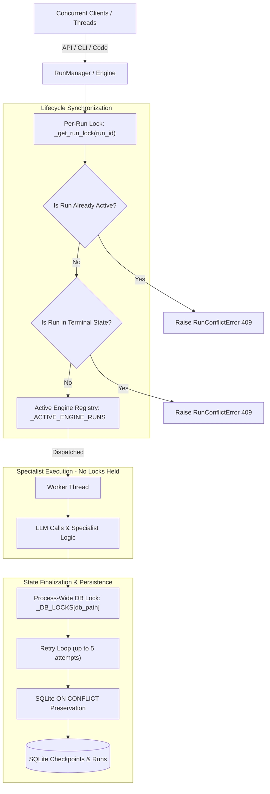

# Task 29: Concurrent Run Isolation & Lifecycle Race Safety Report

**Date**: 2026-10-23  
**Author**: Antigravity  
**Repository**: `multi-agent-orchestrator`  
**Working Directory**: `C:\Users\Dell\OneDrive\Desktop\Project\multi-agent-orchestrator`  

---

## 1. Executive Summary

Task 29 hardened concurrent workflow execution across the Multi-Agent Orchestration System when multiple workflow runs are submitted, cancelled, timed out, resumed, or completed concurrently.

Previous tasks implemented persistence, async background runs, cooperative cancellation, deadlines, and rate limiting. However, concurrency hazards existed at the lifecycle boundaries:
1. **SQLite Database Locking and Step Contention**: Concurrent writes to SQLite without cross-thread locking could trigger `sqlite3.OperationalError: database is locked`, step-calculation collisions, or late stale updates overwriting terminal states (`completed`, `cancelled`, `timed_out`).
2. **Duplicate Run Submissions & Resumptions**: Rapid concurrent calls to `start_run` or `resume_run` with the same `run_id` could dispatch multiple worker threads executing the same workflow state simultaneously.
3. **Cancellation & Completion Races**: Cancellation requests arriving just as a worker thread was completing could cause indeterminate terminal statuses, or allow late worker writes to overwrite `cancelled` back to `completed`.
4. **Stale Cancellation State Across Resumes**: Resuming a cancelled or timed-out run could inherit a cancelled `CancellationToken` if tokens in the global `CancellationRegistry` were not cleanly refreshed.
5. **Escalation Races on Cancelled Runs**: In-flight subtask retries could escalate to the HITL ReviewQueue even after the workflow had already been cancelled or timed out.

### Key Accomplishments
1. **Process-Wide SQLite Concurrency Safety & Terminal State Preservation**:
   - Added `_DB_LOCKS` keyed by canonical database file path in `src/orchestrator/persistence/store.py` to serialize `save_checkpoint` operations and prevent step-calculation race conditions.
   - Added automatic exponential-backoff retries for transient `sqlite3.OperationalError` (busy/locked).
   - Enforced SQLite `ON CONFLICT` atomic protection in the `runs` table: terminal statuses (`completed`, `failed`, `cancelled`, `timed_out`, `approved`, `edited`, `rejected`) cannot be overwritten by stale non-terminal updates, and monotonic `latest_step = MAX(runs.latest_step, excluded.latest_step)` is guaranteed.
2. **Per-Run Granular Locks & RunManager Lifecycle Synchronization**:
   - Implemented reentrant per-run locks (`self._run_locks`) in `RunManager` (`src/orchestrator/api/manager.py`).
   - Atomically guarded `start_run`, `resume_run`, `cancel_run`, and worker completion hooks without holding global locks during LLM inference or specialist execution.
   - Prevented duplicate starts or resumes with `RunConflictError` (HTTP 409).
   - Enforced that late cancellations on completed runs raise `RunConflictError` (HTTP 409), and late-finishing workers cannot overwrite a run that was already cancelled.
3. **Graph Execution Engine Run Isolation & Active Execution Registry**:
   - Added `_ACTIVE_ENGINE_RUNS` guarded by `_ENGINE_RUNS_LOCK` in `src/orchestrator/graph/builder.py` preventing concurrent multi-thread invocation of `run_task` or `resume_task` for the identical `run_id`.
   - Prevented post-cancellation / post-timeout HITL escalations by suppressing ReviewQueue pushes if the run was already cancelled or deadline-expired.
4. **Clean Token Lifecycle on Resume**:
   - Added `create_fresh(run_id, deadline, timeout_seconds)` to `CancellationRegistry` ensuring resumed runs always receive a fresh, uncancelled token.
   - Guaranteed automatic registry cleanup in `finally` blocks across all execution outcomes (success, failure, cancellation, timeout).
5. **Comprehensive Deterministic Concurrency Test Suite**:
   - Created `tests/test_concurrency_lifecycle.py` containing 11 deterministic concurrency tests using thread pools, barriers, and events (zero arbitrary sleep loops).
   - Validated full regression across all existing test suites: `test_cancellation_deadlines.py` (19/19 passed), `test_api.py` (16/16 passed), `test_persistence_resume.py` (12/12 passed), `test_cli.py` (11/11 passed), `test_end_to_end.py` (13/13 passed).
   - Clean linting with `ruff check src/ tests/` (0 errors).

---

## 2. Identified Concurrency Hazards & Root Causes

| Hazard | Root Cause | Failure Mode |
|---|---|---|
| **SQLite DB Collisions** | SQLite in WAL or rollback mode locks during concurrent writes across threads; `latest_step` was computed from `COUNT(*)` without mutex. | `sqlite3.OperationalError: database is locked`, duplicate step numbers, corrupt history. |
| **Terminal State Overwrite** | Background worker threads finishing after `cancel_run` called `store.save_checkpoint` with `completed` state. | Run initially marked `cancelled` flips back to `completed`, corrupting audit trail. |
| **Duplicate Run Execution** | `RunManager.start_run` and `resume_run` checked `_active_runs` without holding a per-run lock across validation and registration. | Two worker threads dispatched for identical `run_id`, leading to duplicate specialist executions and corrupted state. |
| **Cancellation vs Completion Race** | `cancel_run` and worker completion raced to update `_results_cache` and `store`. | If completion finished first, cancellation might still set `cancelled`; or if cancellation finished first, worker might overwrite with `completed`. |
| **Stale Cancellation on Resume** | Resuming a cancelled run accessed the global `CancellationRegistry` which retained the old pre-cancelled `CancellationToken`. | Resumed workflow immediately halted as "cancelled" at the pre-dispatch check. |
| **Spurious Escalation** | A subtask failing on its retry loop after the workflow deadline expired or was cancelled would proceed into `do_escalate`. | Run escalated to HITL review queue despite being dead or cancelled. |

---

## 3. Implemented Synchronization & Architecture

### 3.1 Concurrency Model & Locking Hierarchy

To prevent deadlocks while ensuring absolute race safety:
1. **Never hold locks during slow operations**: No global locks or per-run locks are held during LLM API calls, specialist tool execution, or network I/O.
2. **Lock Hierarchy**:
   - Level 1: `RunManager._run_locks[run_id]` (Per-run lock for lifecycle state transitions)
   - Level 2: `RunManager._lock` (Internal dict synchronization for `_active_runs` and `_results_cache`)
   - Level 3: `_DB_LOCKS[canonical_path]` (Process-wide file-path lock for SQLite step calculations and writes)
   - Level 4: `_ENGINE_RUNS_LOCK` (Engine-level set guard for `_ACTIVE_ENGINE_RUNS`)



### 3.2 Key Implementations by Module

#### 1. SQLite Persistence Hardening (`src/orchestrator/persistence/store.py`)
- **Process-Wide DB Mutex**:
  ```python
  _DB_LOCKS: dict[str, threading.RLock] = {}
  _DB_LOCKS_MUTEX = threading.Lock()
  ```
  Guarantees that threads within the process share a reentrant lock keyed by the normalized database path.
- **Transient Error Retries**:
  ```python
  for attempt in range(max_retries):
      try:
          ...
      except sqlite3.OperationalError as exc:
          if "locked" in str(exc).lower() or "busy" in str(exc).lower():
              time.sleep(0.02 * (2 ** attempt))
  ```
- **Terminal Status Immunity**:
  SQLite `INSERT ... ON CONFLICT(run_id) DO UPDATE` ensures terminal states (`completed`, `failed`, `cancelled`, `timed_out`, etc.) cannot be downgraded by stale non-terminal updates, and `latest_step` is strictly monotonic:
  ```sql
  ON CONFLICT(run_id) DO UPDATE SET
      task = excluded.task,
      status = CASE
          WHEN runs.status IN ('completed', 'failed', 'cancelled', 'timed_out', 'approved', 'edited', 'rejected')
               AND excluded.status NOT IN ('completed', 'failed', 'cancelled', 'timed_out', 'approved', 'edited', 'rejected')
          THEN runs.status
          WHEN runs.status = 'completed' AND excluded.status = 'cancelled'
          THEN runs.status
          ELSE excluded.status
      END,
      latest_step = MAX(runs.latest_step, excluded.latest_step),
      updated_at = excluded.updated_at
  ```

#### 2. Cancellation Registry Hardening (`src/orchestrator/graph/cancellation.py`)
- Added `create_fresh(run_id, deadline, timeout_seconds)` to `CancellationRegistry` which unregisters any stale token and initializes a fresh, uncancelled `CancellationToken`.
- Added `is_timed_out` property on `CancellationToken` and updated `check_cancelled()` to enforce execution deadlines cooperatively.

#### 3. Graph Engine Run Isolation (`src/orchestrator/graph/builder.py`)
- Added `_ACTIVE_ENGINE_RUNS` set guarded by `_ENGINE_RUNS_LOCK` to reject duplicate concurrent calls to `run_task` or `resume_task` with `ValueError("Task '...' is already executing concurrently.")`.
- In `_run_fallback`: ensured mutual exclusion between cancellation and timeout flags so one cannot overwrite the other.
- In `_execute_subtask_with_review`: skipped escalation/ReviewQueue push if the workflow was already cancelled or expired.
- Guaranteed cleanup of tokens and active run markers in `finally` blocks.

#### 4. RunManager Concurrency Hardening (`src/orchestrator/api/manager.py`)
- Added granular per-run locks: `self._run_locks: dict[str, threading.RLock]`.
- Synchronized `start_run`: verified run is neither actively running in-process nor already terminal in persistence.
- Synchronized `resume_run`: verified run is not currently executing, not already fully completed, and not awaiting review queue resolution.
- Synchronized `cancel_run`:
  - If already terminal (`completed`, `failed`, `timed_out`), raises `RunConflictError` (HTTP 409).
  - If already cancelled, returns idempotent 200 OK.
  - If active, atomically flags active run state and signals the `CancellationToken`.
- Hardened worker completion hooks (`_run_worker` and `_resume_worker`):
  - Verified under `run_lock` whether cancellation won the race while the worker was processing. If cancelled, the final state status is preserved as `cancelled` and late `completed` states are discarded.

---

## 4. Files Modified and Created

| File | Action | Description |
|---|---|---|
| `src/orchestrator/persistence/store.py` | **Modified** | Added `_DB_LOCKS`, retry loop on busy/locked DB, atomic SQLite `ON CONFLICT` terminal-status preservation, and thread-safe in-memory access. |
| `src/orchestrator/graph/cancellation.py` | **Modified** | Added `create_fresh()` method, `is_timed_out` property, and unified deadline checks. |
| `src/orchestrator/graph/builder.py` | **Modified** | Added `_ACTIVE_ENGINE_RUNS` guard against duplicate concurrent engine runs, mutual exclusion of terminal statuses, escalation suppression for aborted runs, and fresh tokens on resume. |
| `src/orchestrator/api/manager.py` | **Modified** | Added per-run reentrant locks (`self._run_locks`), atomic state transitions, duplicate run rejection (`RunConflictError`), and late-worker overwrite protection. |
| `tests/test_concurrency_lifecycle.py` | **Created** | Comprehensive deterministic test suite (11 tests) validating concurrent run isolation, race resolution, duplicate conflicts, and terminal status preservation. |
| `reports/TASK_29_CONCURRENCY_SAFETY.md` | **Created** | This comprehensive task report. |

---

## 5. Verification & Test Execution Results

### 5.1 Concurrency & Lifecycle Race Safety Test Suite (`test_concurrency_lifecycle.py`)

All 11 deterministic concurrency tests passed:
1. `test_concurrent_distinct_runs_isolation`: Verified two distinct runs executing simultaneously with overlapping specialists experience zero cross-talk and isolated persistence.
2. `test_concurrent_cancellation_isolation`: Verified cancelling Run 1 while active does not disturb concurrent Run 2, which completes successfully.
3. `test_duplicate_start_run_conflict`: Verified concurrent duplicate start requests and duplicate starts on terminal runs raise `RunConflictError`.
4. `test_duplicate_resume_run_conflict`: Verified attempting to resume an already running workflow raises `RunConflictError`.
5. `test_engine_duplicate_run_conflict`: Verified calling `run_task` concurrently with identical `run_id` raises `ValueError`.
6. `test_cancellation_racing_with_completion`: Verified cancelling a completed run returns HTTP 409 conflict and preserves completed status in persistence.
7. `test_timeout_racing_with_cancellation`: Verified deterministic terminal status when deadline and cancellation collide.
8. `test_late_worker_completion_after_cancellation`: Verified a late-finishing worker thread cannot overwrite `cancelled` back to `completed`.
9. `test_concurrent_checkpoint_writes_safety`: Verified 10 concurrent threads writing checkpoints to SQLite produce strictly monotonic steps (1..11) without lock collisions, and late stale updates cannot overwrite terminal `completed` status.
10. `test_cancellation_registry_cleanup_after_outcomes`: Verified tokens are reliably removed from `CancellationRegistry` after normal completion, failure, cancellation, and timeout.
11. `test_resumed_run_gets_fresh_cancellation_token`: Verified resuming an earlier cancelled run obtains a clean token and completes without stale cancellation residue.

**Result**: `11 passed in 17.28s`

### 5.2 Full Regression Suite

```bash
# Concurrency Lifecycle
python -m pytest tests/test_concurrency_lifecycle.py
# Result: 11 passed in 17.28s

# Cancellation & Deadlines, API, Persistence Resume
python -m pytest tests/test_cancellation_deadlines.py tests/test_api.py tests/test_persistence_resume.py
# Result: 47 passed in 50.46s

# CLI & End-to-End
python -m pytest tests/test_cli.py tests/test_end_to_end.py
# Result: 24 passed in 66.09s
```

### 5.3 Static Analysis & Linting

```bash
python -m ruff check src/ tests/
# Output: All checks passed!
```

---

## 6. Remaining Concurrency Limitations

1. **Multi-Process Concurrency (Distributed Deployments)**:
   - In-process locks (`_DB_LOCKS`, `_run_locks`, and `_ACTIVE_ENGINE_RUNS`) safely serialize multi-threaded workloads within a single Python process.
   - For multi-process deployments (e.g. running multiple Uvicorn workers or distributed orchestrator nodes), the SQLite database is protected by file-level WAL locking and retry loops. However, `_active_runs` tracking and in-memory cancellation tokens currently reside in the process memory. A distributed coordination layer (e.g., Redis pub/sub or database-backed cancellation leases) would be recommended for multi-host clusters.
2. **External Tool Subprocess Cancellation**:
   - While Python threads and API calls cooperatively check cancellation tokens and unstarted futures are canceled immediately, an OS child process spawned by a specialist tool cannot be forcibly terminated without platform-specific process group termination (`SIGKILL` / `TerminateProcess`).

---

## 7. Working-Tree Preservation & Git Status

In accordance with strict workflow instructions:
- No commits or pushes have been executed (`git commit` / `git push` were NOT run).
- All changes from Tasks 01–28 and Task 29 remain preserved in the local working directory.
- Execution halts strictly upon completion of Task 29.
