# Task 30: Graceful Shutdown & Interrupted Run Recovery Report

**Date**: 2026-10-23  
**Author**: Antigravity  
**Repository**: `multi-agent-orchestrator`  
**Working Directory**: `C:\Users\Dell\OneDrive\Desktop\Project\multi-agent-orchestrator`  

---

## 1. Executive Summary

Task 30 implemented reliable graceful application shutdown and startup recovery for workflows interrupted by process termination, server restarts, or abrupt crashes across the Multi-Agent Orchestration System.

Previously, if the FastAPI server or execution manager was stopped while runs were in flight, worker threads could be killed mid-execution leaving run records stuck in `'running'` status indefinitely. Upon restart, there was no automated mechanism to detect or transition interrupted runs into an explicit, resumable state, and duplicate execution or accidental overwriting of terminal states remained a hazard.

### Key Accomplishments
1. **Admission Control & Graceful Shutdown**:
   - Implemented `is_shutting_down` flag in `RunManager` (`src/orchestrator/api/manager.py`).
   - Immediately stops accepting new workflow execution requests (`start_run`) and resumptions (`resume_run`) once shutdown is initiated, raising `ShutdownError`.
   - Translated `ShutdownError` to `HTTP 503 Service Unavailable` in FastAPI route endpoints (`src/orchestrator/api/routes.py`).
   - Cooperatively signals active workflows using their existing `CancellationToken` (with reason `"Application shutdown"`).
   - Waits up to a configurable grace period (`api_shutdown_grace_seconds`, default: `5.0s`, configurable up to `300.0s`).
   - Prevents indefinite process hangs by terminating background executors via `executor.shutdown(wait=False, cancel_futures=True)` when the grace period expires.
   - Any lingering un-terminated runs are safely marked as `interrupted` in SQLite persistence before exit.
2. **Startup Interrupted-Run Recovery**:
   - Added `find_interrupted_runs()` and `recover_run_as_interrupted()` to `CheckpointStore` (`src/orchestrator/persistence/store.py`).
   - Scans SQLite for runs left in active status (`status IN ('running', 'in_progress')`).
   - Recovers active runs into an explicit, documented `interrupted` status, preserving all completed subtask results, answers, and checkpoint history.
   - Guarantees terminal status immunity: runs that reached terminal states (`completed`, `failed`, `cancelled`, `timed_out`, `approved`, `edited`, `rejected`) are never overwritten.
   - Strictly idempotent: repeated recovery passes do not duplicate checkpoints or alter state.
   - Avoids unintended double execution: recovered runs remain safely paused until explicitly resumed by a user or client.
3. **Resume Safety & Validation**:
   - Updated `resume_task` (`src/orchestrator/graph/builder.py`) and `resume_run` (`src/orchestrator/api/manager.py`) to recognize `interrupted` status alongside `cancelled` and `timed_out`.
   - Resuming an interrupted run clears interruption reasons, transitions status to `running`, and executes only unfinished subtasks while preserving completed work.
   - Added validation against corrupt or empty plans: attempting to resume an empty plan raises a clear `ValueError` before dispatching workers, preserving persisted history.
4. **FastAPI Lifespan Integration**:
   - Configured FastAPI `lifespan` context manager in `src/orchestrator/api/server.py`.
   - Automatically runs interrupted-run recovery during startup and initiates graceful shutdown during server termination.
   - Updated `/health` endpoint to reflect `status: "shutting_down"` while shutdown is active.
5. **Comprehensive Deterministic Testing & Regression Verification**:
   - Created `tests/test_shutdown_recovery.py` with 11 deterministic tests covering graceful shutdown, 503 rejection, cooperative worker completion, grace period expiry, startup recovery, idempotency, terminal status preservation, interrupted run resumption, empty-plan safety, and FastAPI lifespan integration.
   - Ran full regression across existing test suites (93/93 passed across all relevant modules).
   - Static analysis passed cleanly with `ruff check src/ tests/` (0 errors).

---

## 2. Files Modified and Created

| File | Action | Description |
|---|---|---|
| `src/orchestrator/config.py` | **Modified** | Added `api_shutdown_grace_seconds` (default: 5.0s) and `api_recovery_on_startup` (default: True) settings with validation and diagnostics. |
| `src/orchestrator/persistence/store.py` | **Modified** | Added `find_interrupted_runs()`, `recover_run_as_interrupted()`, and `recover_interrupted_runs()` with strict idempotency and terminal status immunity. |
| `src/orchestrator/graph/state.py` | **Modified** | Documented `interrupted` in `GraphState` status literal and added `interrupted`, `interrupted_reason` fields. |
| `src/orchestrator/graph/builder.py` | **Modified** | Updated `_run_fallback` and `resume_task` to accept `interrupted` status, use token deadlines accurately, and validate non-empty execution plans on resume. |
| `src/orchestrator/api/manager.py` | **Modified** | Added `ShutdownError`, `is_shutting_down` property, bounded `shutdown(grace_period, store)`, `recover_interrupted_runs()`, and empty-plan resume validation. |
| `src/orchestrator/api/routes.py` | **Modified** | Caught `ShutdownError` to return HTTP 503 Service Unavailable on `POST /runs` and `POST /runs/{run_id}/resume`; updated `/health` to report `shutting_down`. |
| `src/orchestrator/api/server.py` | **Modified** | Configured FastAPI `lifespan` context manager to trigger startup recovery on boot and graceful shutdown on termination. |
| `src/orchestrator/api/client.py` | **Modified** | Added `ApiServiceUnavailableError` (HTTP 503) mapping in typed client error translation. |
| `ui/api_client.py` | **Modified** | Exported `ApiServiceUnavailableError` in dashboard client module. |
| `docs/DEVELOPER_GUIDE.md` | **Modified** | Documented graceful shutdown lifecycle, startup recovery semantics, configuration parameters, resume procedures, and known limitations. |
| `tests/test_shutdown_recovery.py` | **Created** | 11 deterministic tests validating shutdown rejection, cooperative cancellation, timeout expiry, recovery, idempotence, and resumption. |
| `reports/TASK_30_SHUTDOWN_RECOVERY.md` | **Created** | This technical report. |

---

## 3. Architecture & Design

### 3.1 Shutdown & Recovery Lifecycle Flow

```mermaid
flowchart TD
    subgraph Graceful Shutdown
        SIG[SIGINT / SIGTERM / manager.shutdown] --> Reject["Set is_shutting_down = True\nReject new runs with HTTP 503"]
        Reject --> Cancel["Signal active CancellationToken\nreason: 'Application shutdown'"]
        Cancel --> Wait{"Active runs == 0 or\ntimeout >= grace_period?"}
        Wait -->|Runs finish| StopExec["executor.shutdown(wait=False)"]
        Wait -->|Grace period expires| Interrupt["Mark lingering active runs as 'interrupted'"]
        Interrupt --> StopExec
    end

    subgraph Startup Recovery
        Boot[FastAPI Lifespan / App Boot] --> Scan["Scan SQLite: status IN ('running', 'in_progress')"]
        Scan --> CheckTerm{"Is status or latest checkpoint\nalready terminal?"}
        CheckTerm -->|Yes| Skip["Preserve terminal status (no-op)"]
        CheckTerm -->|No| Transition["Save checkpoint transition='interrupted'\nruns.status='interrupted'"]
        Transition --> Ready["Ready: run safely paused,\ncompleted subtasks preserved"]
    end

    subgraph Resuming Interrupted Run
        Client[CLI --resume / API POST /runs/id/resume] --> ResValid{"Has valid plan?"}
        ResValid -->|No| Err["Raise ValueError (HTTP 400)\nPreserve history"]
        ResValid -->|Yes| ResEngine["resume_task: status='running'\nSkip completed subtasks"]
        ResEngine --> Finish["Execute remaining subtasks\nFinal status='completed'"]
    end
```



### 3.2 State Transition Matrix

| Previous State | Trigger | New State | Notes |
|---|---|---|---|
| `running` | Server shutdown within grace period | `cancelled` | Worker cooperatively acknowledges cancellation and finalizes current step. |
| `running` | Server shutdown exceeds grace period | `interrupted` | Worker did not finish in time; executor forced shutdown and store marked `interrupted`. |
| `running` | Process crashed / hard killed | `interrupted` | Next process startup recovery detects un-finalized run and marks `interrupted`. |
| `interrupted` | `recover_interrupted_runs()` called again | `interrupted` | Idempotent no-op; no new checkpoint generated. |
| `interrupted` | User calls `resume_task` or `POST /resume` | `running` | Resets status to `running`, clears interruption reason, executes remaining subtasks. |
| `completed` / `failed` | Startup recovery | Unchanged | Terminal states are strictly immutable. |

---

## 4. Test Execution & Verification

### 4.1 Focused Shutdown & Recovery Tests (`tests/test_shutdown_recovery.py`)

```bash
python -m pytest tests/test_shutdown_recovery.py -v
```

**Results**: `11 passed in 4.77s`
1. `test_graceful_shutdown_stops_accepting_new_runs`: Verified `start_run` and `resume_run` raise `ShutdownError` once shutdown begins.
2. `test_api_returns_503_during_shutdown`: Verified FastAPI endpoints return HTTP 503 Service Unavailable with clear diagnostics during shutdown.
3. `test_graceful_shutdown_cooperative_worker_completion`: Verified background workers receive cancellation signal, finish within grace period, and record `cancelled` status.
4. `test_graceful_shutdown_grace_period_expiry`: Verified shutdown exits boundedly without hanging indefinitely when a specialist is blocked, marking lingering runs as `interrupted`.
5. `test_startup_recovery_identifies_and_marks_interrupted`: Verified in-flight runs from previous crashes are recovered into `interrupted` status, preserving completed subtasks.
6. `test_startup_recovery_is_idempotent`: Verified repeated calls to recovery do not duplicate checkpoints or modify steps.
7. `test_startup_recovery_never_overwrites_terminal_status`: Verified completed, failed, cancelled, and timed-out runs retain their exact terminal status.
8. `test_resume_recovered_interrupted_run`: Verified an interrupted run resumes cleanly, executes only remaining subtasks, and reaches `completed`.
9. `test_resume_fails_safely_on_missing_or_empty_plan`: Verified attempting to resume a run with an empty plan raises `ValueError` and preserves history.
10. `test_fastapi_lifespan_startup_and_shutdown`: Verified FastAPI `lifespan` executes startup recovery on boot and graceful shutdown on exit.
11. `test_health_endpoint_reports_shutting_down`: Verified `GET /health` reports `status: "shutting_down"` when shutdown is initiated.

### 4.2 Full Regression Suite

```bash
# Shutdown & Concurrency
python -m pytest tests/test_shutdown_recovery.py tests/test_concurrency_lifecycle.py -q
# Result: 22 passed in 18.24s

# Cancellation & Deadlines
python -m pytest tests/test_cancellation_deadlines.py -q
# Result: 19 passed in 23.41s

# API, Persistence Resume, CLI, and End-to-End
python -m pytest tests/test_api.py tests/test_persistence_resume.py tests/test_cli.py tests/test_end_to_end.py -q
# Result: 52 passed in 68.12s
```
**Total Verified Tests**: 93 passed with 0 failures across all relevant test modules.

### 4.3 Static Analysis & Code Style

```bash
python -m ruff check src/ tests/
# Output: All checks passed!
```

---

## 5. Remaining Limitations

1. **Hard Process Termination (`SIGKILL` / Out-Of-Memory Killer)**:
   - Immediate OS kills (`kill -9`) terminate the process without executing python `atexit` or FastAPI lifespan handlers. In this scenario, running runs will remain marked as `running` in SQLite until the next process startup, where startup recovery will safely transition them to `interrupted`.
2. **External Tool Side-Effects During Crash**:
   - While the orchestrator tracks completed subtasks and guarantees that completed subtasks are not re-executed upon resumption, if an external non-idempotent tool (e.g., third-party billing API or external email dispatch) was interrupted mid-flight, exactly-once external side-effects cannot be guaranteed without two-phase commit or idempotency keys provided by the external service.
3. **Multi-Host Process Coordination**:
   - In-process locks (`self._run_locks`, `_is_shutting_down`) safely govern single-node multi-threaded deployments. For multi-node Kubernetes or Celery deployments across multiple distinct machines, a distributed coordinator (e.g., Redis cluster locks or database lease tokens) is recommended.

---

## 6. Git Status & State Preservation Confirmation

- **Working Tree Preserved**: All files and uncommitted changes from Tasks 01–29 and Task 30 remain intact in `C:\Users\Dell\OneDrive\Desktop\Project\multi-agent-orchestrator`.
- **No Git Commit/Push**: `git commit` and `git push` were strictly not executed.
- **Workflow Boundary**: Execution halts strictly upon completion of Task 30; Task 31 was NOT started.
