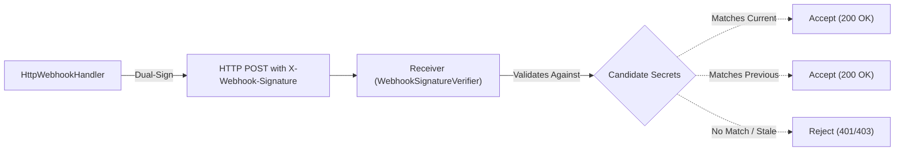

# Task 53: Webhook Payload Signing, Replay Protection & Secret Rotation

## Executive Summary
Task 53 hardens external webhook notifications delivered by the transactional outbox subsystem
(`orchestrator.notifications`) by introducing cryptographic payload signing, timestamp-based replay
protection, constant-time signature verification, and zero-downtime secret rotation.

All implementations strictly preserve backward compatibility with Tasks 01–52. When signing is not
configured, outbound webhooks continue to operate without signature headers. When enabled, requests attach
versioned HMAC-SHA256 signatures binding timestamp, persistent event ID, and exact serialized payload bytes.

---

## Architecture & Signing Specifications

### 1. Cryptographic HMAC-SHA256 Signing Format
Outbound webhook POST requests are signed over a canonical context string incorporating:
1. Integer Unix epoch timestamp (`timestamp`).
2. Persistent outbox event UUID (`event_id`).
3. Exact serialized request body bytes (`payload_bytes`).

Canonical signature computation:
```python
prefix = f"{timestamp}.{event_id}.".encode()
signed_content = prefix + payload_bytes
signature_hash = hmac.new(secret.encode(), signed_content, hashlib.sha256).hexdigest()
```

Versioned signature header:
- Single Active Secret:
  `X-Webhook-Signature: t=1730376000,v1=9f86d081884c7d659a2feaa0c55ad015a3bf4f1b2b0b822cd15d6c15b0f00a08`
- Dual Secrets (Rotation Window):
  `X-Webhook-Signature: t=1730376000,v1=<current_hash>,v1=<previous_hash>`

### 2. Timestamp Tolerance & Replay Protection
- **Configurable Drift Window**: `notification_webhook_signature_tolerance_seconds` (default: 300.0s).
- **Stale Expiry Check**: If `current_time - timestamp > tolerance`, the request is rejected as expired.
- **Future-Dating Check**: If `current_time - timestamp < -tolerance`, the request is rejected.
- **Replay Protection Cache**: `ReplayProtectionCache` tracks verified event IDs and their expiry
  thresholds. Repeated presentations of the same `event_id` within the tolerance window are rejected
  as duplicate replay attacks.
- **Constant-Time Verification**: All signature comparisons use `hmac.compare_digest()` to prevent
  timing side-channel vulnerabilities.

### 3. Safe Zero-Downtime Secret Rotation
Secret rotation is supported via a two-phase credential lifecycle:
- `notification_webhook_signing_secret`: Primary signing secret.
- `notification_webhook_signing_secret_previous`: Optional previous secret during a migration window.
- When both secrets are configured, outbound requests emit dual `v1` signatures.
- Receivers verify against either secret, allowing seamless rotation without synchronized deployments.
- Raw signing secrets are never logged, stored in audit records, or exposed via diagnostics.



---

## Configuration Settings Reference

Added settings in `orchestrator.config.Settings`:

| Field Name | Default | Description |
| :--- | :--- | :--- |
| `notification_webhook_signing_secret` | `None` | HMAC-SHA256 active signing secret. |
| `notification_webhook_signing_secret_previous` | `None` | Previous secret during rotation. |
| `notification_webhook_signature_header` | `"X-Webhook-Signature"` | Header name for HMAC signature. |
| `notification_webhook_signature_tolerance_seconds` | `300.0` | Timestamp drift window (seconds). |

---

## Files Created & Modified

### Modified Files
- `src/orchestrator/config.py`: Added signing settings, tolerance validation, and secret-safe diagnostics.
- `src/orchestrator/notifications/webhook.py`: Added payload signing, dual-signature emission during
  rotation, secret redaction, and exact-byte body dispatching.
- `src/orchestrator/notifications/registry.py`: Extracted signing settings in `_create_webhook_handler`.
- `src/orchestrator/notifications/__init__.py`: Exported signing and verification utilities.
- `README.md`: Added webhook signing variables to configuration table.
- `docs/DEVELOPER_GUIDE.md`: Added Section 12.18 covering signing, replay protection, and rotation.

### Created Files
- `src/orchestrator/notifications/signing.py`: HMAC signature generation, header formatting/parsing,
  replay cache, and constant-time verifier.
- `tests/test_webhook_signing.py`: Comprehensive test suite for signing, tampering, replay, and rotation.
- `reports/TASK_53_WEBHOOK_SIGNING_REPLAY_PROTECTION.md`: This technical deliverable report.

---

## Verification & Test Results

### 1. Webhook Signing Test Suite (`tests/test_webhook_signing.py`)
- `test_signature_generation_and_header_formatting`: Deterministic HMAC computation and parsing.
- `test_dual_signature_header_formatting_for_rotation`: Dual `v1` header formatting.
- `test_signature_verification_success`: Valid payload passes verification.
- `test_payload_tampering_rejected`: 1-byte alteration fails verification.
- `test_timestamp_tampering_rejected`: Altered timestamp fails verification.
- `test_event_id_tampering_rejected`: Altered event ID fails verification.
- `test_expired_timestamp_rejected`: Request older than tolerance rejected as expired.
- `test_future_dated_timestamp_rejected`: Excessively future-dated request rejected.
- `test_replay_protection_detection`: Duplicate event ID within window rejected as replay attack.
- `test_secret_rotation_verification_against_either_secret`: Dual-signed request passes with either secret.
- `test_signing_secrets_redacted_in_errors`: Both secrets redacted with `[REDACTED_SECRET]`.
- `test_e2e_webhook_delivery_with_valid_signature`: Full HTTP delivery with mock server verification.
- `test_outbox_dispatcher_integration_with_signed_webhooks`: Dispatcher delivers signed outbox events.
- `test_concurrent_webhook_signing_delivery`: Multi-threaded delivery generates distinct valid signatures.
- `test_configuration_validation_and_diagnostics_for_signing`: Tolerance bounds and secret-safe diagnostics.

**Result**: 15 passed in 2.93s.

### 2. Full Outbox & Webhook Regression Suite
- `tests/test_webhook_signing.py`: 15 passed
- `tests/test_notification_webhook.py`: 31 passed
- `tests/test_transactional_outbox.py`: 12 passed
- `tests/test_outbox_observability_recovery.py`: 10 passed
- **Combined Result**: 68 passed in 16.05s.

### 3. Core Subsystem Regression Suites
- **Approval Lifecycle Suite** (90 tests): 90 passed in 10.43s.
- **Static Analysis**: `python -m ruff check src tests` passed with 0 errors.
- **Line Length Check**: 0 lines exceed 110 characters across all Task 53 files.

---

## Operational Invariants & Limitations

1. **At-Least-Once Delivery**:
   Signatures authenticate payload authenticity and detect replays within the tolerance window.
   Webhook receivers must maintain durable deduplication using `X-Idempotency-Key` or `X-Event-ID`.
2. **Clock Synchronization**:
   Receivers and dispatchers must synchronize clocks via NTP; clock skew exceeding `tolerance_seconds`
   will cause signature verification rejections.
3. **No Automatic Tool Approvals**:
   Signing guarantees notification transport security; it never bypasses approval gates or auto-approves
   human-in-the-loop workflows.
4. **No Git Commit / Push**:
   In strict accordance with instructions, no git commit or push operations were performed.
