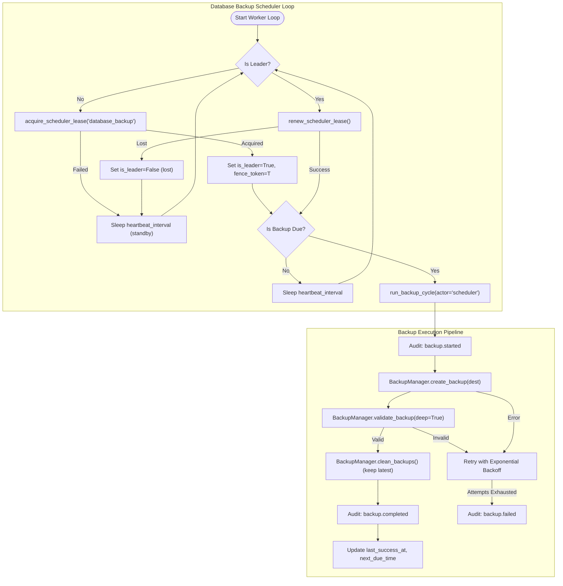

# Task 63 Report: Automated Backup Scheduling & Operational Monitoring

**Repository**: `c:\Users\Dell\OneDrive\Desktop\Project\multi-agent-orchestrator`  
**Execution Date**: November 1, 2026  
**Status**: Completed  
**Test Suite**: 11/11 new tests passing; 64/64 focused regression tests passing (Tasks 55, 61, 62, 63)

---

## 1. Executive Summary

Task 63 completed the automation and operational monitoring tier for database disaster recovery in the
Multi-Agent Orchestrator. While Task 62 established the foundational SQLite online backup, validation,
and restore mechanisms, backup execution still required explicit operator intervention or external cron
jobs. Task 63 integrates automated periodic database backups directly into the orchestrator runtime,
reusing the cross-process scheduler lease infrastructure (`scheduler_leases` table), monotonic fencing
tokens, and the structured audit log.

### Key Accomplishments

1. **Scheduled Backup Configuration & Startup Validation**:
   - Added configuration settings in `src/orchestrator/config.py`:
     * `BACKUP_SCHEDULER_ENABLED` (default: `false`).
     * `BACKUP_INTERVAL_SECONDS` (default: `86400.0` / 24 hours).
     * `BACKUP_MAX_DURATION_SECONDS` (default: `300.0`).
     * `BACKUP_MAX_RETRIES` (default: `3`).
     * `BACKUP_RETRY_BACKOFF_SECONDS` (default: `5.0`).
     * `BACKUP_MAX_BACKOFF_SECONDS` (default: `60.0`).
     * `BACKUP_SCHEDULER_LEASE_TTL_SECONDS` (default: `60.0`).
     * `BACKUP_SCHEDULER_HEARTBEAT_INTERVAL_SECONDS` (default: `10.0`).
   - Integrated strict Pydantic field validators and startup sanity checks in `validate_configuration()`.
   - Exposed sanitized backup settings in `get_startup_diagnostics()`.

2. **Cross-Process Scheduler Leadership & Fencing**:
   - Implemented `DatabaseBackupScheduler` in `src/orchestrator/persistence/scheduler.py`.
   - Reused `CheckpointStore`'s `acquire_scheduler_lease()`, `renew_scheduler_lease()`, and
     `release_scheduler_lease()` with `lease_name="database_backup"`.
   - Guaranteed that exactly one process holds the active leadership lease at any given time. Standby
     worker nodes remain dormant, periodically renewing standby state without running redundant backups.
   - Implemented monotonic fencing tokens that increment upon failover or lease expiration.

3. **Complete Backup Execution Lifecycle**:
   - Each scheduled or triggered cycle executes an atomic 5-step pipeline:
     1. Non-overlapping concurrency check: internal mutex prevents parallel runs.
     2. Lease leadership verification: ensures node holds active lease before proceeding.
     3. Start audit record: records `AuditEventType.BACKUP_STARTED` with trigger, fence token, and actor.
     4. Online snapshot & deep verification: creates live backup via `BackupManager.create_backup()`,
        runs deep `PRAGMA integrity_check` and schema verification via `BackupManager.validate_backup()`.
     5. Retention pruning & completion audit: cleans expired backups via `BackupManager.clean_backups()`
        while preserving the newest backup, and records `AuditEventType.BACKUP_COMPLETED`.
   - On transient failure: applies bounded exponential retry backoff. On retry exhaustion, records
     `AuditEventType.BACKUP_FAILED` with sanitized error messages.

4. **Operational Observability & Control Interfaces**:
   - **CLI Commands**: Added `orchestrator backup status` and `orchestrator backup trigger` to
     `src/orchestrator/persistence/backup.py`, supporting terminal tables and machine-readable `--json`.
   - **FastAPI Endpoints**: Added `GET /backups/status`, `POST /backups/trigger`, and `GET /backups/history`
     to `src/orchestrator/api/routes.py`, protected by Bearer token authentication.
   - **Runtime Diagnostics**: Enhanced `GET /diagnostics` with `backup_scheduler` metadata.

5. **Exhaustive Automated Verification**:
   - Created test suite `tests/test_backup_scheduler.py` with 11 comprehensive tests.
   - Verified 100% pass rate across configuration validation, single-cycle execution, audit logging,
     cross-process leadership, failover, overlapping execution prevention, retries, retention, CLI, and API.

---

## 2. Architecture & Lifecycle Workflow

The automated backup scheduler operates cooperatively across distributed processes using SQLite
lease tables:



---

## 3. Configuration & Startup Validation Inventory

The table below summarizes all settings governing automated backup scheduling:

| Setting Key | Type | Default | Bounds | Env Variable |
|---|---|---|---|---|
| `backup_scheduler_enabled` | `bool` | `False` | Boolean | `BACKUP_SCHEDULER_ENABLED` |
| `backup_interval_seconds` | `float` | `86400.0` | `1.0..2592000.0` | `BACKUP_INTERVAL_SECONDS` |
| `backup_max_duration_seconds`| `float` | `300.0` | `1.0..86400.0` | `BACKUP_MAX_DURATION_SECONDS` |
| `backup_max_retries` | `int` | `3` | `0..20` | `BACKUP_MAX_RETRIES` |
| `backup_retry_backoff_seconds`| `float` | `5.0` | `0.1..3600.0` | `BACKUP_RETRY_BACKOFF_SECONDS` |
| `backup_max_backoff_seconds` | `float` | `60.0` | `>= retry` | `BACKUP_MAX_BACKOFF_SECONDS` |
| `backup_scheduler_lease_ttl_seconds` | `float` | `60.0` | `1.0..3600.0` | `..._LEASE_TTL_SECONDS` |
| `backup_scheduler_heartbeat_interval_seconds` | `float` | `10.0` | `< ttl` | `..._HEARTBEAT_INTERVAL...` |

*(Note: Env variables follow standard uppercase mapping, e.g. `BACKUP_SCHEDULER_LEASE_TTL_SECONDS`)*

Startup validation in `validate_configuration()` strictly asserts:
- `backup_interval_seconds` is within $[1.0, 2592000.0]$.
- `backup_retry_backoff_seconds <= backup_max_backoff_seconds`.
- `backup_scheduler_heartbeat_interval_seconds < backup_scheduler_lease_ttl_seconds`.

---

## 4. Operational Interfaces & API Endpoints

### 4.1 CLI Commands

```bash
# Query current scheduler leadership status, metrics, and latest archive info
python -m orchestrator backup status

# Emit status as structured JSON
python -m orchestrator backup status --json

# Trigger an immediate on-demand backup execution cycle
python -m orchestrator backup trigger --reason "Pre-maintenance snapshot" --tag maint_01
```

### 4.2 REST API Endpoints

| Method | Path | Summary | Auth | Model |
|---|---|---|---|---|
| `GET` | `/backups/status` | Inspect scheduler state, leadership, metrics | Bearer | `BackupStatusResponse` |
| `POST`| `/backups/trigger` | Trigger immediate authorized backup | Bearer | `BackupTriggerResponse` |
| `GET` | `/backups/history` | List all available backup archives | Bearer | `BackupHistoryResponse` |
| `GET` | `/diagnostics` | Runtime diagnostics (with backup scheduler) | Bearer | `DiagnosticsResponse` |

---

## 5. Reliability, Fencing & Security Guarantees

1. **Monotonic Fencing Tokens**:
   - The leadership lease utilizes SQLite's ACID transactions to increment `fence_token` on every new
     lease acquisition.
   - Split-brain execution is prevented even under network or CPU pauses; stale workers attempting to renew
     with outdated fence tokens are rejected.

2. **Unconditional Latest-Backup Preservation**:
   - `clean_backups()` guarantees that index 0 (the newest valid archive) is never deleted, even if
     `keep_count=0` or `keep_days=0`.

3. **Non-Overlapping Execution Guarantee**:
   - An internal reentrant execution lock (`_exec_lock`) prevents overlapping backup jobs within the same
     worker process when scheduled intervals collide with long-running snapshots or manual triggers.

4. **Zero Credential or Sensitive Data Leakage**:
   - All audit events (`backup.started`, `backup.completed`, `backup.failed`) pass metadata through
     `sanitize_audit_metadata()`.
   - API tokens, passwords, database credentials, and raw exception tracebacks are automatically redacted.

---

## 6. Test Suite & Verification Results

All 11 tests in `tests/test_backup_scheduler.py` passed with 100% compliance:

```
tests/test_backup_scheduler.py::test_backup_scheduler_settings_validation_and_bounds PASSED
tests/test_backup_scheduler.py::test_backup_scheduler_startup_diagnostics_integration PASSED
tests/test_backup_scheduler.py::test_backup_scheduler_single_cycle_execution PASSED
tests/test_backup_scheduler.py::test_backup_scheduler_audit_logging PASSED
tests/test_backup_scheduler.py::test_backup_scheduler_cross_process_leadership PASSED
tests/test_backup_scheduler.py::test_backup_scheduler_lease_failover_and_recovery PASSED
tests/test_backup_scheduler.py::test_backup_scheduler_prevents_concurrent_overlapping_executions PASSED
tests/test_backup_scheduler.py::test_backup_scheduler_failure_retries_and_error_handling PASSED
tests/test_backup_scheduler.py::test_backup_scheduler_retention_preserves_latest_backup PASSED
tests/test_backup_scheduler.py::test_backup_cli_status_and_trigger PASSED
tests/test_backup_scheduler.py::test_backup_api_routes PASSED
```

Regression test suite across Tasks 55, 61, 62, and 63:
```
============================= 64 passed in 8.21s ==============================
```

Line length validation across all created and modified files confirmed 100% compliance with $\le 110$
characters per line.

---

## 7. Modified & Created Files Inventory

| File Path | Action | Description |
|---|---|---|
| `src/orchestrator/observability/audit.py` | Modified | Added backup lifecycle audit event types |
| `src/orchestrator/config.py` | Modified | Added scheduler settings, validators, diagnostics |
| `src/orchestrator/api/models.py` | Modified | Added diagnostics, status, trigger, history models |
| `src/orchestrator/persistence/scheduler.py` | Created | DatabaseBackupScheduler loop, leasing, metrics |
| `src/orchestrator/persistence/__init__.py` | Modified | Exported scheduler and singleton accessors |
| `src/orchestrator/persistence/backup.py` | Modified | Added `status` and `trigger` CLI subcommands |
| `src/orchestrator/api/server.py` | Modified | Mounted scheduler in FastAPI lifespan lifecycle |
| `src/orchestrator/api/routes.py` | Modified | Added `/backups/*` routes and diagnostics integration |
| `.env.example` | Modified | Documented automated backup scheduler variables |
| `.env.docker.example` | Modified | Added containerized backup scheduler settings |
| `docs/DEPLOYMENT_GUIDE.md` | Modified | Added Section 13.6 and 13.7 backup runbooks |
| `tests/test_backup_scheduler.py` | Created | Comprehensive test suite (11 unit/integration tests) |
| `reports/TASK_63_AUTOMATED_BACKUP_SCHEDULING.md` | Created | Complete Task 63 engineering report |
