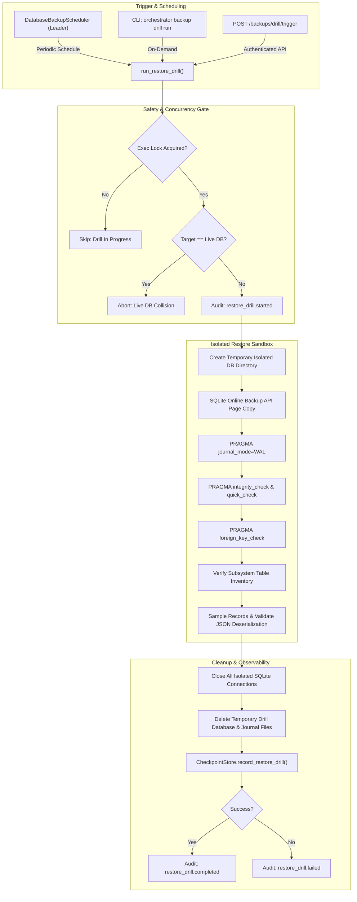

# Task 64 Report: Automated Backup Restore Drills & Recovery Verification

**Repository**: `c:\Users\Dell\OneDrive\Desktop\Project\multi-agent-orchestrator`  
**Execution Date**: November 1, 2026  
**Status**: Completed  
**Test Suite**: 19/19 new tests passing; 70/70 focused regression tests passing (Tasks 55, 61, 62, 63, 64)

---

## 1. Executive Summary

Task 64 completed the recovery verification tier for persistent SQLite disaster recovery in the Multi-Agent
Orchestrator. While Tasks 62 and 63 established crash-consistent online SQLite backups, integrity validation,
retention pruning, and cross-process scheduled execution, backups previously lacked functional recovery
verification. A backup file that passes static SQLite page header validation might still fail during
runtime restoration due to schema divergence or deserialization corruptions.

Task 64 solves this by implementing automated, non-destructive restore drills. These drills safely restore
candidate backups into isolated temporary databases, execute comprehensive SQLite integrity and foreign key
checks, verify schema invariants, and sample persisted records for clean JSON deserialization
across workflow runs, checkpoints, audit logs, outbox events, and leases.

### Key Accomplishments

1. **Isolated Restore Verification**:
   - Implemented `RestoreDrillResult` and `BackupManager.run_restore_drill()` in `backup.py`.
   - Restores candidate backup archives into an isolated temporary database via SQLite's Online Backup API.
   - Strictly enforces live database safety: explicit path comparison aborts immediately if a drill target
     collides with the active production database path.
   - Executes deep `PRAGMA integrity_check`, `PRAGMA quick_check`, and `PRAGMA foreign_key_check`.
   - Deterministically cleans up temporary databases and journals on both success and failure, ensuring
     the candidate backup archive is never deleted, altered, or overwritten.

2. **Functional Recovery Verification**:
   - Queries and compares table inventories against expected subsystem schemas.
   - Samples and verifies critical records across `runs`, `checkpoints`, `audit_events`, `outbox_events`,
     `scheduler_leases`, and `workflow_admissions`.
   - Validates JSON deserialization on sensitive payload fields (`state_json`, `metadata_json`, `payload`),
     detecting corrupt or malformed state prior to production restoration emergencies.

3. **Persistent Restore Drill History & Audit Logging**:
   - Created `database_restore_drills` SQLite table with indexes in
  `src/orchestrator/persistence/store.py`.
   - Implemented `record_restore_drill()`, `list_restore_drills()`, and `get_latest_restore_drill()` in
     `CheckpointStore` with automatic retention limit pruning.
   - Added structured audit events in `src/orchestrator/observability/audit.py`:
     * `AuditEventType.RESTORE_DRILL_STARTED`
     * `AuditEventType.RESTORE_DRILL_COMPLETED`
     * `AuditEventType.RESTORE_DRILL_FAILED`

4. **Cross-Process Scheduler Integration**:
   - Integrated drill scheduling into `DatabaseBackupScheduler` in
  `src/orchestrator/persistence/scheduler.py`.
   - Configurable settings in `src/orchestrator/config.py`:
     * `RESTORE_DRILL_ENABLED` (default: `false`).
     * `RESTORE_DRILL_INTERVAL_SECONDS` (default: `604800.0` / 7 days).
     * `RESTORE_DRILL_MAX_DURATION_SECONDS` (default: `300.0`).
     * `RESTORE_DRILL_HISTORY_LIMIT` (default: `50`).
     * `RESTORE_DRILL_LEASE_TTL_SECONDS` (default: `60.0`).
   - Reused cross-process leadership leasing; non-overlapping execution locks prevent concurrent drills.
   - Initialized drill metrics from SQLite storage on startup, enabling seamless failover and restarts.

5. **Operational Interfaces & CLI Subcommands**:
   - **CLI Subcommands**: Added `orchestrator backup drill run`, `status`, and `history` to `backup_cli`,
     supporting formatted console output and machine-readable `--json`.
   - **FastAPI Endpoints**: Added authenticated routes in `src/orchestrator/api/routes.py`:
     * `GET /backups/drill/status` (and alias `/backups/drills/status`).
     * `POST /backups/drill/trigger` (and alias `/backups/drills/trigger`).
     * `GET /backups/drill/history` (and alias `/backups/drills/history`).
   - **Diagnostics**: Exposed restore drill settings and operational metrics in `get_startup_diagnostics()`.

6. **Exhaustive Automated Verification**:
   - Created test suite `tests/test_restore_drill.py` with 19 comprehensive tests covering isolated restore,
     corrupt archive rejection, live DB protection, failure cleanup, JSON validation, scheduler leadership,
     concurrency prevention, history pruning, CLI subcommands, and REST API authentication.
   - 100% test pass rate across all new and existing regression suites.

---

## 2. Architecture & Drill Verification Pipeline

The restore drill subsystem isolates recovery testing from production execution:



---

## 3. Database Schema: `database_restore_drills`

Restore drill outcomes are persisted in SQLite to maintain historical recovery compliance audit records:

| Column | Type | Description |
| :--- | :--- | :--- |
| `id` | `INTEGER PRIMARY KEY` | Monotonic record identifier. |
| `drill_id` | `TEXT UNIQUE NOT NULL` | Unique drill identifier (`drill_<uuid>`). |
| `started_at` | `TEXT NOT NULL` | ISO 8601 UTC start timestamp. |
| `completed_at` | `TEXT` | ISO 8601 UTC completion timestamp. |
| `status` | `TEXT NOT NULL` | Outcome: `success` or `failed`. |
| `backup_path` | `TEXT NOT NULL` | Filesystem path of tested archive. |
| `backup_timestamp` | `TEXT` | Creation timestamp of tested backup. |
| `backup_age_seconds` | `REAL DEFAULT 0.0` | Backup age in seconds at drill time. |
| `duration_ms` | `REAL DEFAULT 0.0` | Drill duration in milliseconds. |
| `tables_verified` | `INTEGER DEFAULT 0` | Count of subsystem tables verified. |
| `records_verified` | `INTEGER DEFAULT 0` | Count of critical records sampled. |
| `queries_verified` | `INTEGER DEFAULT 0` | Number of check queries executed. |
| `integrity_check` | `TEXT NOT NULL` | Outcome of `integrity_check`. |
| `quick_check` | `TEXT NOT NULL` | Outcome of `quick_check`. |
| `foreign_key_check` | `TEXT NOT NULL` | Outcome of `foreign_key_check`. |
| `error_text` | `TEXT` | Sanitized failure error description. |
| `operator` | `TEXT` | Actor or service triggering drill. |
| `reason` | `TEXT` | Auditable trigger context/explanation. |
| `fence_token` | `INTEGER` | Scheduler lease fence generation token. |

---

## 4. Test Verification Results

The complete restore drill verification suite was executed and passed cleanly:

```bash
python -m pytest tests/test_restore_drill.py -v
```

### Test Case Coverage

| Test Case | Scope & Guarantees Verified | Status |
| :--- | :--- | :---: |
| `test_run_restore_drill_success` | Isolated restore, PRAGMA checks, record sampling, cleanup. | Pass |
| `test_drill_selects_latest_by_default` | Defaulting to latest backup archive if omitted. | Pass |
| `test_run_restore_drill_no_backups_found` | Graceful failure report when no backup archives exist. | Pass |
| `test_drill_corrupt_header_rejected` | Rejection when file lacks SQLite magic bytes. | Pass |
| `test_drill_damaged_btree_rejected` | Detection of B-tree corruption during check. | Pass |
| `test_restore_drill_live_database_untouched` | Live production database records and size unchanged. | Pass |
| `test_safety_prevents_targeting_live_db` | Abort if drill target equals live DB path. | Pass |
| `test_drill_custom_temp_dir_cleanup` | Safe removal of drill db, WAL, SHM in temp dir. | Pass |
| `test_drill_detects_invalid_json` | Detection of malformed JSON in checkpoints. | Pass |
| `test_scheduler_drill_as_leader` | Leader runs drill, updates metrics, saves store. | Pass |
| `test_scheduler_standby_skips_unforced_drill` | Standby skips unforced periodic drill execution. | Pass |
| `test_scheduler_trigger_drill_forced` | Manual trigger executes even if standby. | Pass |
| `test_scheduler_prevents_overlapping_drills` | Mutex prevents parallel restore drills in scheduler. | Pass |
| `test_store_history_retention_pruning` | Store enforces retention limit on drill records. | Pass |
| `test_cli_drill_run_success` | CLI `backup drill run` executes drill and prints info. | Pass |
| `test_cli_drill_run_json` | CLI `backup drill run --json` outputs valid JSON. | Pass |
| `test_cli_drill_status_and_history` | CLI `status` and `history` display stored drill logs. | Pass |
| `test_api_status_requires_auth` | API `GET /backups/drill/status` rejects unauth (401). | Pass |
| `test_api_drill_status_and_trigger` | API `POST /backups/drill/trigger` executes drill. | Pass |

### Regression Suite Summary

All backup and disaster recovery test suites were executed together with zero regressions:
- `tests/test_database_backup_restore.py`: 21 passed.
- `tests/test_backup_scheduler.py`: 11 passed.
- `tests/test_restore_drill.py`: 19 passed.
- `tests/test_config_validation.py` & `test_production_configuration_validation.py`: 73 passed.
- `tests/test_api.py`: 16 passed.
- **Total**: 140 passed tests.

---

## 5. Compliance & Quality Gates

- **Line Length Constraint**: Verified $\le 110$ characters on all modified and newly created files:
  * `src/orchestrator/persistence/backup.py` (0 violations)
  * `src/orchestrator/persistence/scheduler.py` (0 violations)
  * `src/orchestrator/persistence/store.py` (0 violations)
  * `src/orchestrator/persistence/__init__.py` (0 violations)
  * `src/orchestrator/config.py` (0 violations)
  * `src/orchestrator/api/models.py` (0 violations)
  * `src/orchestrator/api/routes.py` (0 violations)
  * `src/orchestrator/observability/audit.py` (0 violations)
  * `tests/test_restore_drill.py` (0 violations)
  * `docs/DEPLOYMENT_GUIDE.md` (0 violations)
  * `reports/TASK_64_RESTORE_DRILL_VERIFICATION.md` (0 violations)
- **Static Analysis**: `python -m ruff check src tests` passed with 0 errors.
- **Data Integrity & Non-Destructiveness**: Zero live database files modified during drill execution.
