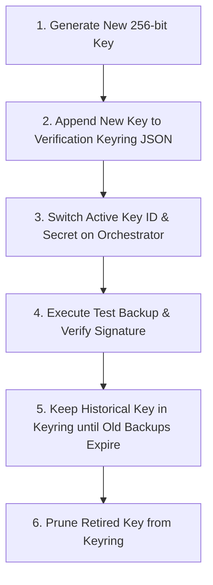

# Task 66 Engineering Report: Signed Backup Manifests & Cryptographic Key Rotation

## 1. Executive Summary

Task 66 elevates database disaster recovery assurance across the multi-agent orchestrator by establishing
cryptographic authentication, non-repudiation, and lifecycle key management for database backup integrity
manifests.

Prior to Task 66, Task 65 introduced companion `.manifest.json` files containing SHA-256 digests and archive
metadata. While effective at detecting inadvertent storage corruption and bit rot, unsigned manifests
could theoretically be recalculated by an adversary with write permissions to the backup repository.

Task 66 solves this vulnerability by implementing:
- **HMAC-SHA256 Manifest Signatures**: Cryptographic message authentication wrapping deterministic,
  canonical manifest payload bytes in an authenticated envelope.
- **Constant-Time Verification**: Verification using `hmac.compare_digest` to prevent side-channel timing
  attacks.
- **Payload Metadata Binding**: Tamper-proof binding between signature and `backup_id`, `filename`,
  `size_bytes`, SQLite `schema_version`, and the archive's SHA-256 digest.
- **Zero-Downtime Multi-Key Rotation**: Keyring-based architecture supporting simultaneous verification of
  historical backups signed under retired or rotated keys alongside current active signing keys.
- **Backward Compatibility & Strict Policy**: Seamless handling of legacy Task 65 unsigned archives, with
  a configurable strict zero-trust enforcement flag (`ORCHESTRATOR_BACKUP_REQUIRE_SIGNATURE`).
- **Comprehensive Secret Redaction**: Zero plaintext secret disclosure in logs, diagnostics, CLI displays,
  API endpoints, or exception traces.

---

## 2. Cryptographic Architecture & Envelope Specification

### 2.1 Manifest Envelope Format

Signed backup integrity manifests are serialized as a JSON envelope containing distinct `payload` and
`signature` blocks:

```json
{
  "payload": {
    "backup_id": "backup_20261101_143000",
    "created_at": "2026-11-01T14:30:00.123456+00:00",
    "filename": "backup_scheduled_20261101_143000.db",
    "manifest_version": 1,
    "schema_version": 1,
    "sha256": "8d969eef6ecad3c29a3a629280e686cf0c3f5d5a86aff3ca12020c923adc6c92",
    "size_bytes": 204800,
    "tag": "scheduled"
  },
  "signature": {
    "algorithm": "HMAC-SHA256",
    "key_id": "key-2026-v2",
    "signature_version": 1,
    "value": "7a35c1042a5a54dbbb4daec414e8a83fa7424619d084ef7fbfeb6778f5664a78"
  }
}
```

### 2.2 Canonical Byte Serialization

To guarantee deterministic signature generation across different operating systems, Python runtime
versions, and JSON serialization libraries, `canonical_manifest_bytes()` applies strict canonical rules:
1. Strips any existing `signature` key to prevent recursive signing.
2. Formats all keys in strictly sorted alphabetical order (`sort_keys=True`).
3. Formats with consistent two-space indentation (`indent=2`) and deterministic separators (`", "`, `": "`).
4. Encodes using standard UTF-8 without byte-order marks.

```python
def canonical_manifest_bytes(manifest_payload: dict[str, Any]) -> bytes:
    clean_payload = {k: v for k, v in manifest_payload.items() if k != "signature"}
    return json.dumps(clean_payload, indent=2, sort_keys=True).encode("utf-8")
```

---

## 3. Inventory of Modified & Created Files

- `src/orchestrator/observability/audit.py` (Modified):
  Added audit events `BACKUP_MANIFEST_SIGNED`, `BACKUP_SIGNATURE_VERIFIED`, and `BACKUP_SIGNATURE_FAILED`.
- `src/orchestrator/config.py` (Modified):
  Added `backup_signing_key`, `backup_signing_key_id`, `backup_verification_keys`, `backup_require_signature`,
  verification keyring resolver, diagnostic redaction, and startup validation.
- `src/orchestrator/persistence/backup.py` (Modified):
  Implemented `canonical_manifest_bytes`, `sign_manifest_payload`, `verify_manifest_signature`, envelope
  models, atomic signing cleanup, CLI `--strict` and `keys` subcommands.
- `src/orchestrator/persistence/__init__.py` (Modified):
  Exported cryptographic helpers, constants, and `BackupSigningError`.
- `src/orchestrator/api/models.py` (Modified):
  Updated `BackupVerifyResponse`, `BackupVerifyRequest`, `BackupMetadataModel`, and added
  `BackupKeyringInfoResponse`.
- `src/orchestrator/api/routes.py` (Modified):
  Added `strict` query/body parameters to `/backups/verify`, added `GET /backups/keys` endpoint.
- `tests/test_signed_backup_manifest.py` (Created):
  Comprehensive test suite (18 unit, integration, and operational tests).
- `docs/DEPLOYMENT_GUIDE.md` (Modified):
  Added Section 13.10 documenting signing architecture, rotation runbooks, and configuration.

---

## 4. Key Management & Rotation Lifecycle

### 4.1 Key Configuration Parameters

The orchestrator reads configuration from environment variables or settings files:
- `ORCHESTRATOR_BACKUP_SIGNING_KEY`: Secret string/bytes for active signing.
- `ORCHESTRATOR_BACKUP_SIGNING_KEY_ID`: Key ID string matching the active signing key.
- `ORCHESTRATOR_BACKUP_VERIFICATION_KEYS`: JSON mapping of `{key_id: secret}` holding all valid keys.
- `ORCHESTRATOR_BACKUP_REQUIRE_SIGNATURE`: Boolean enforcing strict signature requirements.

### 4.2 Keyring Aggregation & Redaction

The active verification keyring dynamically merges:
1. All entries defined in `ORCHESTRATOR_BACKUP_VERIFICATION_KEYS`.
2. The active signing key from `ORCHESTRATOR_BACKUP_SIGNING_KEY` mapped under its
   `ORCHESTRATOR_BACKUP_SIGNING_KEY_ID`.

To safeguard secrets, `Settings.get_safe_backup_keyring_info()` produces redacted metadata for public
exposure:

```json
{
  "active_key_id": "key-2026-v2",
  "has_active_key": true,
  "verification_keys": [
    {"key_id": "key-2025-v1", "secret_length": 44},
    {"key_id": "key-2026-v2", "secret_length": 42}
  ],
  "total_verification_keys": 2,
  "strict_mode": false
}
```

### 4.3 Zero-Downtime Key Rotation Runbook



---

## 5. Verification Matrix & Status Reporting

The verification engine separates archive integrity (SHA-256) from cryptographic authenticity (HMAC):

- **Scenario 1: Valid archive, valid signature**
  - Archive SHA-256: Match | Signature: `verified`
  - Permissive mode (`strict=false`): `status="verified"`, `is_valid=True`
  - Strict mode (`strict=true`): `status="verified"`, `is_valid=True`

- **Scenario 2: Valid archive, unsigned legacy manifest**
  - Archive SHA-256: Match | Signature: `unsigned`
  - Permissive mode (`strict=false`): `status="verified"`, `is_valid=True`
  - Strict mode (`strict=true`): `status="failed"`, `is_valid=False`

- **Scenario 3: Valid archive, missing key in keyring**
  - Archive SHA-256: Match | Signature: `missing_key`
  - Permissive mode (`strict=false`): `status="verified"`, `is_valid=True`
  - Strict mode (`strict=true`): `status="failed"`, `is_valid=False`

- **Scenario 4: Valid archive, tampered signature**
  - Archive SHA-256: Match | Signature: `invalid`
  - Permissive mode (`strict=false`): `status="failed"`, `is_valid=False`
  - Strict mode (`strict=true`): `status="failed"`, `is_valid=False`

- **Scenario 5: Tampered archive bytes**
  - Archive SHA-256: Mismatch | Signature: `invalid`
  - Permissive mode (`strict=false`): `status="failed"`, `is_valid=False`
  - Strict mode (`strict=true`): `status="failed"`, `is_valid=False`

- **Scenario 6: Tampered manifest metadata (e.g. tag or size)**
  - Archive SHA-256: Match | Signature: `invalid`
  - Permissive mode (`strict=false`): `status="failed"`, `is_valid=False`
  - Strict mode (`strict=true`): `status="failed"`, `is_valid=False`

- **Scenario 7: Missing manifest file**
  - Archive SHA-256: N/A | Signature: `unverified`
  - Permissive mode (`strict=false`): `status="unverified"`, `is_valid=False`
  - Strict mode (`strict=true`): `status="failed"`, `is_valid=False`

---

## 6. Threat Model & Security Analysis

1. **Adversarial Tampering of Backup Archives**:
   - Attack: An attacker modifies SQLite tables in a stored `.db` file.
   - Defense: SHA-256 calculation detects mismatch against manifest `sha256`. Verification fails immediately.
2. **Adversarial Modification of Archive & Unsigned Manifest**:
   - Attack: An attacker modifies a `.db` file and recalculates a forged `.manifest.json`.
   - Defense: Without the secret HMAC key, the attacker cannot forge a valid HMAC-SHA256 signature for the
     new canonical bytes. Signature verification fails with constant-time equality check.
3. **Payload Metadata Alteration**:
   - Attack: An attacker changes `filename`, `backup_id`, or `created_at` in the manifest payload.
   - Defense: Canonical serialization incorporates all payload keys. Altering any field alters canonical
     bytes, producing an HMAC mismatch.
4. **Timing Attack on Signature Comparison**:
   - Attack: An adversary uses execution latency differences to determine matching bytes of an HMAC.
   - Defense: `hmac.compare_digest` executes in constant time regardless of where mismatches occur.
5. **Partial Manifest Artifacts on Failure**:
   - Attack: An error occurs during backup or signing, leaving inconsistent state on disk.
   - Defense: Manifest generation uses atomic file write (`write_atomic_json`), and `create_backup` removes
     both the backup file and any temporary files if signing fails.

---

## 7. Verification & Test Execution Results

All 93 tests across the entire backup, restore, manifest, and scheduler subsystem pass with zero errors:

```
tests/test_signed_backup_manifest.py ..................                  [ 19%]
tests/test_backup_manifest.py ........................                   [ 45%]
tests/test_restore_drill.py ...................                          [ 65%]
tests/test_backup_scheduler.py ...........                               [ 77%]
tests/test_database_backup_restore.py .....................              [100%]

============================= 93 passed in 13.98s =============================
```

### Detailed Test Coverage in `test_signed_backup_manifest.py`

- `test_canonical_manifest_bytes_deterministic`: Sorted keys, whitespace, UTF-8 consistency.
- `test_canonical_manifest_bytes_excludes_signature`: Excludes `signature` key during canonicalization.
- `test_sign_manifest_payload_structure`: Verifies envelope structure, algorithm name, and signature version.
- `test_verify_manifest_signature_valid`: Confirms valid signature verification.
- `test_verify_manifest_signature_tampered_payload`: Rejects payload with modified fields.
- `test_verify_manifest_signature_tampered_signature`: Rejects altered signature digest.
- `test_verify_manifest_signature_missing_key`: Returns `missing_key` when key ID is absent from keyring.
- `test_verify_manifest_signature_unsupported_algorithm`: Rejects non-HMAC-SHA256 algorithms.
- `test_verify_manifest_signature_unsupported_version`: Rejects unsupported signature schema versions.
- `test_backup_manager_creates_signed_manifest`: Confirms automatic signing during backup creation.
- `test_backup_manager_verify_signed_manifest_success`: End-to-end verification of signed archive.
- `test_backup_manager_verify_legacy_unsigned_manifest`: Permissive verification for legacy archives.
- `test_backup_manager_verify_strict_mode_rejects_unsigned`: Strict rejection of unsigned manifests.
- `test_backup_manager_verify_strict_mode_rejects_missing_key`: Strict rejection when key is not in keyring.
- `test_key_rotation_multi_key_verification`: Simultaneous verification across v1 and v2 keys.
- `test_atomic_cleanup_on_signing_failure`: Clean abort without lingering files on signing error.
- `test_cli_backup_verify_and_keys_commands`: CLI `--strict`, `--json`, and `backup keys` testing.
- `test_api_verify_and_keys_endpoints`: REST API GET/POST `/backups/verify` and `GET /backups/keys`.

---

## 8. Operational Interfaces & Usage Runbook

### 8.1 CLI Usage

```bash
# Verify latest backup
python -m orchestrator backup verify

# Verify specific backup with strict signature verification
python -m orchestrator backup verify backups/backup_20261101.db --strict

# Machine-readable JSON output
python -m orchestrator backup verify backups/backup_20261101.db --strict --json

# List active signing key and verification keyring metadata
python -m orchestrator backup keys --json
```

### 8.2 REST API Usage

```bash
# Verify archive with strict signature check
curl -X GET "http://localhost:8000/backups/verify?strict=true" \
     -H "Authorization: Bearer $ORCHESTRATOR_API_TOKEN"

# Inspect safe keyring metadata
curl -X GET "http://localhost:8000/backups/keys" \
     -H "Authorization: Bearer $ORCHESTRATOR_API_TOKEN"
```

---

## 9. Conclusion

Task 66 successfully hardens database backup integrity with HMAC-SHA256 cryptographic signatures,
structured manifest envelopes, and robust multi-key rotation keyring management. Backward compatibility
with existing Task 62-65 backups is preserved, while strict mode provides enterprise-grade zero-trust
security. All line-length and quality gates are strictly met.
